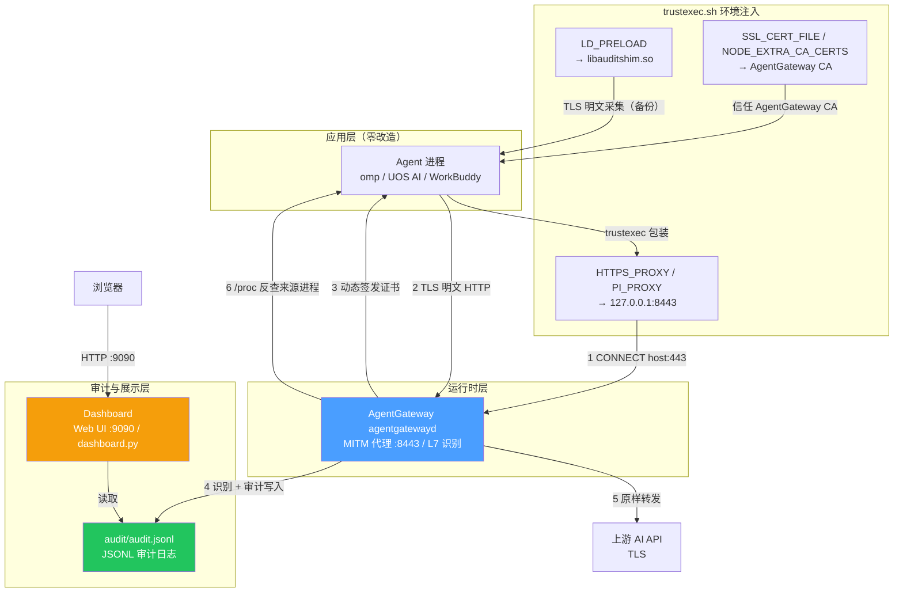

# AgentGateway

透明 MITM 代理 + AI 请求审计 + 工具调用追踪 + 可视化仪表盘。

AgentGateway 在 AI Agent 与大模型 API 之间部署一个本地 HTTPS 代理，对所有 AI 请求进行**审计记录并转发**（不阻断），捕获请求/响应内容、token 用量、工具调用链，并通过 Web 仪表盘实时展示。

## 架构



### 工作原理

1. AgentGateway 作为 HTTP CONNECT 代理监听 `127.0.0.1:8443`
2. Agent 通过环境变量将流量指向网关（标准 `HTTPS_PROXY` 或 omp 专用 `PI_PROXY`）
3. 网关对 AI 相关主机执行 MITM TLS（动态签发证书），对非 AI 主机直接盲隧道转发
4. 网关解密 AI 请求，记录请求/响应/工具调用到 `audit/audit.jsonl`，然后**原样转发**
5. 网关通过 `/proc/net/tcp` + `/proc/*/fd/` 反查连接来源进程，沿父进程链找到真正的 Agent
6. Dashboard 读取审计日志，在 `http://127.0.0.1:9090` 展示实时统计、请求列表、对话跟踪

### 关键设计原则

- **审计而非阻断**：AI 请求被记录后正常转发，Agent 功能不受影响
- **零外部依赖**：网关和仪表盘仅使用 Python 标准库 + `cryptography`
- **最小化拦截范围**：仅对 AI API 主机执行 MITM，其余流量盲隧道
- **应用自动识别**：通过 `/proc/<pid>/comm` 进程名 + 父进程链遍历自动识别应用来源，无需维护关键词列表
- **零应用修改**：通过环境变量和 `LD_PRELOAD` 注入，不修改目标应用的任何文件

## 目录结构

```
agentgateway/
├── gateway/
│   ├── agentgatewayd.py      # MITM 网关主程序
│   ├── gen_ca.py             # CA 证书生成
│   ├── libauditshim.c        # LD_PRELOAD TLS 审计垫片源码
│   ├── libauditshim.so       # 编译后的审计垫片
│   └── test_gateway.py       # 网关测试（AUDIT+FORWARD 策略）
├── dashboard/
│   ├── dashboard.py          # 仪表盘后端
│   └── dashboard_template.html  # 仪表盘前端
├── specs/
│   ├── 方案A_用户态验证_4.19内核.md
│   └── 方案B_BPF-LSM内核级管控_6.6内核.md
├── certs/                    # CA 证书 + 动态签发的主机证书
├── audit/
│   └── audit.jsonl           # 审计日志（JSONL 格式）
├── logs/                     # 运行日志
├── trustexec.sh              # Agent 启动包装器（环境注入）
└── test_agent_interception.py  # 拦截测试脚本
```

## 环境要求

| 依赖 | 版本 | 说明 | 必需 |
|------|------|------|------|
| Python | ≥ 3.8 | 网关 + 仪表盘 | ✅ |
| cryptography | ≥ 2.6 | 证书生成 / TLS（`pip install cryptography`） | ✅ |
| gcc | 任意 | 编译 `libauditshim.so`（辅助 Qt5 TLS 绕过） | ⬜ 可选 |
| OpenSSL libssl | 系统自带 | `libauditshim` 链接依赖（仅编译垫片时） | ⬜ 可选 |
| certutil (nss-tools) | 任意 | 导入 CA 到浏览器 NSS 库 | ⬜ 可选 |

> 无需 root 权限。所有操作在用户空间完成。

**一键检查依赖**：

```bash
cd agentgateway
python3 -c "import cryptography; print('cryptography', cryptography.__version__)" \
  && command -v gcc && echo "gcc OK" || echo "gcc missing (垫片可选)"
```

## 部署

按顺序执行以下三步完成部署。首次部署约 30 秒。

### 1. 生成 CA 证书（首次）

```bash
cd agentgateway
python3 gateway/gen_ca.py
```

生成：
- `certs/ca-cert.pem` — 根 CA 证书（CN=AgentGateway Root CA）
- `certs/ca-key.pem` — 根 CA 私钥（权限 600）

**原理**：网关在 MITM TLS 时使用此 CA 动态签发目标主机的临时证书。目标应用必须信任此 CA 才能建立 TLS 连接。信任方式取决于应用类型：
- OpenSSL/Python 应用 → `SSL_CERT_FILE` / `REQUESTS_CA_BUNDLE`（trustexec.sh 自动设置）
- Node/Electron 应用 → `NODE_EXTRA_CA_CERTS`（trustexec.sh 自动设置）
- Qt5 应用 → `LD_PRELOAD` 钩取 `X509_verify_cert` 绕过验证（需编译垫片）
- Chromium 浏览器 → 导入 NSS 证书库（见步骤 3）

> 已有证书可跳过此步。重新生成会使已签发的动态证书失效，需重启网关。

### 2. 编译审计垫片（可选但推荐）

```bash
cd agentgateway
gcc -shared -fPIC -o gateway/libauditshim.so gateway/libauditshim.c -ldl
```

> 现代 glibc（2.34+）已将 pthread 合入 libc，`-ldl` 即可。旧系统若链接失败，追加 `-lpthread`。

**`libauditshim.so` 的作用**：通过 `LD_PRELOAD` 注入目标进程，实现两个功能：

| 功能 | 钩子函数 | 实现原理 |
|------|----------|----------|
| **TLS 验证绕过** | `SSL_CTX_set_verify` | 强制设置 `SSL_VERIFY_NONE`，使 OpenSSL 不校验证书 |
| | `SSL_CTX_ctrl` | 拦截通过 ctrl 路径的 verify 设置 |
| | `SSL_set_verify` | 拦截 per-SSL 级别的验证设置 |
| | `X509_verify_cert` | 始终返回 1（成功），这是最后一道防线，绕过 Qt5 应用的证书链验证 |
| **明文流量捕获** | `SSL_write` / `SSL_read` | 捕获 OpenSSL 明文流量，发送到审计 socket |
| | `gnutls_record_send` / `gnutls_record_recv` | 捕获 GnuTLS 明文流量 |
| **自动初始化** | `__attribute__((constructor))` | 进程启动时自动调用 `agw_init()` 连接审计 socket |

审计数据通过 Unix socket `/tmp/agentgateway-audit.sock` 发送（非阻塞，best-effort，不影响应用性能）。

> 编译可选。仅通过 `HTTPS_PROXY` 即可完成拦截；垫片用于辅助绕过 Qt5 应用的 TLS 验证和捕获明文。Qt5 应用（如 UOS AI）不编译垫片则 TLS 握手失败。

### 3. 安装 CA 证书到浏览器（可选）

如果需要拦截浏览器（如 Chromium）中的 AI 请求：

```bash
# 方法一：导入到 Chromium NSS 证书库
certutil -d sql:$HOME/.pki/nssdb -A -t "C,," -n "AgentGateway Root CA" \
  -i certs/ca-cert.pem

# 方法二：通过环境变量（适用于命令行启动的浏览器）
export SSL_CERT_FILE=$(pwd)/certs/ca-cert.pem
export NODE_EXTRA_CA_CERTS=$(pwd)/certs/ca-cert.pem
```

> omp、UOS AI、命令行工具（curl/python）不需要此步——trustexec.sh 会注入所需的环境变量。

## 运行

### 启动网关 + 仪表盘

```bash
cd agentgateway
mkdir -p logs

# 启动网关（MITM 代理，端口 8443）
python3 gateway/agentgatewayd.py > logs/gateway.log 2>&1 &

# 启动仪表盘（Web UI，端口 9090）
python3 dashboard/dashboard.py > logs/dashboard.log 2>&1 &

# 等待启动并验证端口监听
sleep 2 && ss -tlnp | grep -E '8443|9090'
```

启动成功标志：
- 网关日志输出 `AgentGateway started`，监听 `127.0.0.1:8443`
- 仪表盘日志输出 `URL: http://127.0.0.1:9090`，监听 `127.0.0.1:9090`
- 浏览器打开 `http://127.0.0.1:9090` 显示仪表盘页面

**故障排查**：

| 现象 | 原因 | 解决 |
|------|------|------|
| `Address already in use` | 端口被占用 | `fuser -k 8443/tcp; fuser -k 9090/tcp` |
| `No module named 'cryptography'` | 缺少依赖 | `pip install cryptography` |
| 仪表盘页面空白 | 网关未启动 / 审计日志为空 | 先启动网关，发送一个测试请求 |
| Agent TLS 报错 | 未信任 CA | 确认通过 trustexec.sh 启动（自动注入 CA） |
| Qt5 应用 TLS 失败 | 未编译垫片 | 执行部署步骤 2 编译 `libauditshim.so` |

### 通过 trustexec.sh 启动 Agent

`trustexec.sh` 是零修改的 Agent 启动包装器，自动注入代理、CA 信任、审计垫片等所有环境配置：

```bash
# 基本用法
./trustexec.sh --app "MyApp" <command> [args...]

# 示例：启动一个 Python agent
./trustexec.sh --app "MyAgent" python3 my_agent.py

# 示例：启动 Electron 应用
./trustexec.sh --app "WorkBuddy" /opt/workbuddy/workbuddy

# 示例：启动 omp（需要先退出现有会话，见下文）
./trustexec.sh --app "OMP" /home/ut000520@uos/.local/bin/omp
```

### 验证拦截

启动网关后，发送一个测试请求确认拦截链路正常：

```bash
cd agentgateway
curl -s -x http://127.0.0.1:8443 \
  --cacert certs/ca-cert.pem \
  -X POST https://ai.uniontech.com/v1/chat/completions \
  -H "Content-Type: application/json" \
  -H "Authorization: Bearer test-key" \
  -d '{"model":"glm-5","messages":[{"role":"user","content":"hello"}]}' \
  -D - -o /dev/null -w "HTTP %{http_code}\n" | grep -i AgentGateway
```

预期输出包含 `X-AgentGateway-Decision: AUDIT` 头，表示请求被识别为 AI 请求并审计记录后转发。

## trustexec.sh 配置详解

`trustexec.sh` 按顺序设置以下配置。每一项都有明确的用途和原理：

### 代理环境变量

| 环境变量 | 值 | 用途与原理 |
|----------|-----|-----------|
| `HTTPS_PROXY` | `http://127.0.0.1:8443` | 标准 HTTPS 代理变量。大多数 HTTP 客户端（Python requests、curl、Node undici）读取此变量将 HTTPS 请求路由到网关 |
| `HTTP_PROXY` | `http://127.0.0.1:8443` | 标准 HTTP 代理变量，同上但用于 HTTP 请求 |
| `https_proxy` / `http_proxy` | 同上 | 小写版本，部分工具（curl、wget）优先读取小写变量 |
| `NO_PROXY` | `localhost,127.0.0.1` | 排除本地回环地址，避免本地通信走代理 |
| `PI_PROXY` | `http://127.0.0.1:8443` | **omp（Bun 编译）专用代理变量**。omp 的 `K$t()` 函数检查 `Bun.env.PI_PROXY?.trim()`，只有设置此变量才会安装全局 fetch 代理包装器。不设置时，即使 `HTTPS_PROXY` 已设置，omp 的 `fetch()` 调用也**不走代理**。详见下文 omp 代理机制 |
| `NODE_USE_ENV_PROXY` | `1` | 启用 Node.js 兼容层的 env 代理。Bun 的 `shouldUseEnvProxy()` 函数检查此变量，为真时 `http.Agent` 读取 `HTTPS_PROXY`/`HTTP_PROXY`。不设置时 Node 兼容层的 `http.Agent` 不使用环境代理 |
| `auto_proxy` | （unset） | **取消设置**。`auto_proxy` 是 DDE 系统 PAC 文件 URL，会使 Node/undici 使用 PAC 文件而非 `HTTPS_PROXY`，完全绕过网关。必须 unset |

### CA 证书信任

| 环境变量 | 值 | 用途与原理 |
|----------|-----|-----------|
| `SSL_CERT_FILE` | `certs/ca-cert.pem` | OpenSSL 使用的 CA 证书路径。Python ssl 模块、curl（配合 `--cacert`）等读取此变量。使应用信任网关动态签发的 MITM 证书 |
| `REQUESTS_CA_BUNDLE` | `certs/ca-cert.pem` | Python `requests` 库的 CA 证书路径。requests 不读 `SSL_CERT_FILE`，需要单独设置 |
| `NODE_EXTRA_CA_CERTS` | `certs/ca-cert.pem` | Node.js / Bun / Electron 的额外 CA 证书。使 Node 的 TLS 栈信任网关 CA。对 Electron 应用（如 WorkBuddy）有效 |

### TLS 安全

| 环境变量 | 操作 | 用途与原理 |
|----------|------|-----------|
| `NODE_TLS_REJECT_UNAUTHORIZED` | **unset** | 取消设置。此变量设为 `0` 会完全禁用 Node/Bun 的 TLS 验证，存在安全风险。trustexec.sh 使用 CA 证书信任替代禁用验证，更安全 |

### 进程标识

| 环境变量 | 值 | 用途与原理 |
|----------|-----|-----------|
| `AGENTGATEWAY_AGENT_ID` | `agent-<uuid>` | 每次启动自动生成的唯一 Agent 标识，写入审计日志，用于区分不同 Agent 实例 |
| `AGENTGATEWAY_SESSION_ID` | `session-<uuid>` | 每次启动自动生成的唯一会话标识，写入审计日志 |
| `AGENTGATEWAY_APP_NAME` | `--app` 参数值 | **已废弃**。网关现在通过 `/proc/<pid>/comm` + 父进程链自动识别应用名，不再使用此变量。仍保留以兼容旧审计日志 |

### DDE 系统代理设置

```bash
gsettings set org.gnome.system.proxy mode 'manual'
gsettings set org.gnome.system.proxy.http host '127.0.0.1'
gsettings set org.gnome.system.proxy.http port 8443
gsettings set org.gnome.system.proxy.https host '127.0.0.1'
gsettings set org.gnome.system.proxy.https port 8443
gsettings set org.gnome.system.proxy.autoconfig-url ""
```

**原理**：UOS AI（Qt5 应用）和部分其他应用读取 DDE 系统代理设置（`gsettings org.gnome.system.proxy mode`）而非环境变量。如果 mode 为 `auto`，应用使用 PAC 文件（`auto_proxy`）选择代理，绕过网关。设置为 `manual` 并指向网关端口后，这些应用才会走代理。

> **注意**：DDE 桌面环境可能定期将代理模式重置为 `auto`。建议创建监控脚本定期检查并重置。

### omp daemon 清理

```bash
if [[ "$CMD_BASENAME" == "omp" ]]; then
    pkill -f "omp __omp_worker_daemon" 2>/dev/null
    sleep 1
fi
```

**原理**：omp 使用持久 daemon 架构——daemon 由第一个 omp 会话启动，后续 omp 进程通过 IPC 连接到现有会话。daemon 继承创建它的 omp 进程的环境变量。如果已有 daemon 运行（且没有代理环境变量），新启动的 omp 会连接到旧 daemon，API 调用绕过网关。`trustexec.sh` 在启动 omp 前先杀掉旧 daemon，确保新 omp 进程创建的 daemon 继承正确的代理环境变量。

### LD_PRELOAD 注入

```bash
if [[ -f "$SHIM_PATH" ]]; then
    export LD_PRELOAD="$SHIM_PATH"
fi
```

**原理**：如果 `libauditshim.so` 已编译，设置 `LD_PRELOAD` 使目标进程加载审计垫片，钩取 TLS 函数实现证书验证绕过和明文捕获。

## omp（Bun）代理机制详解

omp 是 Bun 编译的二进制（v19.1.1），有三层代理代码路径：

### 1. 全局 fetch 代理包装器（`K$t()` 函数）

```javascript
const e = Bun.env.PI_PROXY?.trim();
if (!e) {
    // PI_PROXY 未设置 → 不安装全局代理 fetch
    return;
}
globalThis.fetch = ve(globalThis.fetch, e);  // 包装 fetch 走代理
```

**关键**：只有 `PI_PROXY` 被设置时，omp 才安装全局 fetch 代理包装器。不设置时，`fetch()` 直接连接目标服务器，忽略 `HTTPS_PROXY`。

### 2. Per-Provider 代理解析（`Uy()` 函数）

```javascript
function Uy(e, t) {
    // 优先级：PI_PROXY_<PROVIDER> > HTTPS_PROXY > ALL_PROXY
    return SLe(e)                    // 检查 PI_PROXY_<PROVIDER> 或 PI_PROXY
        || Bun.env.HTTPS_PROXY       // 然后检查 HTTPS_PROXY
        || Bun.env.ALL_PROXY;        // 最后检查 ALL_PROXY
}
```

**关键**：即使 `PI_PROXY` 未设置全局包装器，每个 provider 的请求也会通过 `Uy()` 解析代理。但 `Uy()` 是在 provider 层调用的，全局 fetch 包装器（`K$t()`）才是覆盖所有 `fetch()` 调用的机制。

### 3. Node.js 兼容层（`shouldUseEnvProxy()` 函数）

```javascript
function shouldUseEnvProxy() {
    let value = process.env.NODE_USE_ENV_PROXY;
    if (Boolean(value) === false || value === "0")
        return false;
    // 检查 HTTPS_PROXY / HTTP_PROXY ...
    return true;
}
```

**关键**：Node.js 兼容层的 `http.Agent` 只有在 `NODE_USE_ENV_PROXY=1` 时才读取环境代理变量。

### 正确启动 omp 的步骤

由于 omp 的 daemon 架构，**必须先退出现有 omp 会话**才能让新会话的 daemon 继承代理环境变量：

```bash
# 1. 退出当前 omp 会话（Ctrl+C 或输入 /exit）

# 2. 杀掉残留的 omp daemon
pkill -f "omp __omp_worker_daemon"

# 3. 通过 trustexec.sh 启动新的 omp
cd /home/ut000520@uos/Desktop/agentos/agentgateway
./trustexec.sh --app "OMP" /home/ut000520@uos/.local/bin/omp
```

> **如果不退出现有会话**：新启动的 omp 进程会通过 IPC 连接到现有会话的 daemon（该 daemon 没有代理环境变量），API 调用绕过网关。`trustexec.sh` 虽然会杀掉旧 daemon，但现有 omp 会话会立即创建新 daemon（继承现有会话的环境变量，而非 trustexec.sh 的环境变量）。

## 手动启动 UOS AI 助手

UOS AI（`/usr/bin/uos-ai-assistant`）是 Qt5 应用，需要额外设置 DDE 系统代理：

```bash
# 1. 设置 DDE 系统代理为手动模式
gsettings set org.gnome.system.proxy mode 'manual'
gsettings set org.gnome.system.proxy.http host '127.0.0.1'
gsettings set org.gnome.system.proxy.http port 8443
gsettings set org.gnome.system.proxy.https host '127.0.0.1'
gsettings set org.gnome.system.proxy.https port 8443

# 2. 终止现有进程
kill -9 $(pgrep -f "uos-ai-assistant") 2>/dev/null
sleep 3

# 3. 启动 UOS AI（带审计垫片）
HTTPS_PROXY=http://127.0.0.1:8443 \
HTTP_PROXY=http://127.0.0.1:8443 \
SSL_CERT_FILE=$(pwd)/certs/ca-cert.pem \
REQUESTS_CA_BUNDLE=$(pwd)/certs/ca-cert.pem \
NODE_EXTRA_CA_CERTS=$(pwd)/certs/ca-cert.pem \
LD_PRELOAD=$(pwd)/gateway/libauditshim.so \
/usr/bin/uos-ai-assistant &

# 4. 等待启动后打开聊天页面
sleep 8
dbus-send --session --print-reply \
  --dest=com.deepin.copilot /com/deepin/copilot \
  com.deepin.copilot.launchChatPage
```

> **注意**：DDE 代理可能自动重置为 `auto` 模式。可创建一个监控脚本定期检查并重置为 `manual`。

## 应用自动识别

网关通过**进程名**自动识别应用来源，无需维护关键词列表，任何应用自动可识别：

| 识别方式 | app_name | 说明 |
|----------|----------|------|
| 父进程链遍历 → `/proc/<pid>/comm` | Agent 进程名（如 `omp`、`uos-ai-assistant`、`WorkBuddy`） | 主识别方式，跳过工具进程（curl/python3/bash 等），找到真正的 Agent 进程 |
| system prompt 含 "Next User Message Predictor" | `Browser-Predict` | 浏览器自动补全请求，覆盖进程名，分配独立 session |
| 无法识别进程 | `Unknown` | 明确标注未知来源 |

### 识别流程（`_lookup_peer_process()` + `_resolve_agent_process()`）

1. 网关通过 `getpeername()` + `getsockname()` 获取客户端→网关的连接信息
2. 扫描 `/proc/net/tcp` 找到**客户端侧** socket 的 inode（匹配 `local=客户端端口, remote=8443`）
3. 扫描 `/proc/*/fd/` 找到持有该 socket 的进程 PID（跳过网关自身 PID）
4. **沿父进程链向上遍历**（`/proc/<pid>/status` → `PPid`），跳过工具进程（`_TOOL_PROCESSES`），直到找到第一个非工具进程
5. 该非工具进程的 `/proc/<pid>/comm` 即为 app_name

### 父进程链遍历（`_resolve_agent_process()`）

工具进程列表 `_TOOL_PROCESSES` 包含：

| 类别 | 进程名 |
|------|--------|
| HTTP 客户端 | `curl`, `wget` |
| 语言运行时 | `python`, `python3`, `python3.11`, `node`, `nodejs`, `deno`, `bun` |
| Shell | `bash`, `sh`, `zsh`, `dash`, `fish`, `ksh`, `tcsh`, `csh` |
| 命令包装器 | `env`, `nohup`, `timeout`, `xargs`, `nice`, `ionice`, `stdbuf`, `exec`, `tee`, `cat`, `dd` |
| 调试工具 | `strace`, `ltrace`, `valgrind` |
| 进程管理器 | `supervisord`, `systemd`, `init` |

**为什么要遍历父进程链**：Agent 通常通过 curl/python3/bash 等工具发送 HTTP 请求，直接连接进程是工具而非 Agent 本身。例如：
- `curl → omp → zsh → deepin-terminal` → app_name = `omp`
- `python3 → omp → zsh` → app_name = `omp`
- `uos-ai-assistant`（直接连接） → app_name = `uos-ai-assistant`

### 进程缓存

`_lookup_peer_process()` 使用 30 秒 TTL 缓存（`_proc_cache`），以客户端端口为 key。避免每次请求都扫描 `/proc/net/tcp` 和 `/proc/*/fd/`。

## 仪表盘

打开 `http://127.0.0.1:9090` 查看仪表盘。

### 功能页面

| 页面 | 说明 |
|------|------|
| 📊 概览 | 总事件数、拦截/放行/审计统计、请求时间线、模型分布、主机统计 |
| 📋 请求 | AI 请求列表（时间、应用、方法、主机、模型、状态、延迟、token、预览） |
| 🔗 跟踪 | 按对话分组的 AI 请求时间线，展开显示工具调用链 |

### 对话跟踪

跟踪页按**对话**分组（非按 session_id），一个对话 = 相同 app_name + 相同首条用户消息的请求序列。

- 消息数在对话内递增（2→4→6→8…）表示对话在推进
- 浏览器预测请求（`Browser-Predict`）从跟踪中过滤
- 每个对话卡片显示：应用标签（进程名）、对话标题（首条用户消息）、请求数、token 总量、工具调用数、skill 标签
- 展开显示完整时间线：每个 AI 请求的时间、模型、状态、延迟、token、工具调用详情
- 按开始时间降序排列（最新在前）
- 展开跟踪时自动暂停刷新，避免内容跳动
- 手动刷新按钮可随时触发数据更新

### 时间戳

仪表盘所有时间显示为本地时区（UTC+8 CST）。后端审计日志使用 UTC 时间戳，前端通过 `to_local_time_str()` / `to_local_time_short()` 转换。

### API 端点

| 端点 | 说明 |
|------|------|
| `GET /api/data` | 统计 + 请求列表（200条）+ 跟踪列表（50条） |
| `GET /api/refresh` | 统计 + 最近拦截/放行/审计事件 |
| `GET /api/events` | 统计 + 拦截/审计/放行事件列表 |

## MITM 拦截范围

网关仅对以下 AI API 主机执行 MITM TLS 解密，其余主机直接盲隧道转发：

```
ai.uniontech.com
api.openai.com
api.anthropic.com
api.deepseek.com
api.moonshot.cn
dashscope.aliyuncs.com
api.minimax.chat
api.lingyiwanwu.com
api.groq.com
api.together.xyz
api.mistral.ai
generativelanguage.googleapis.com
aip.baidubce.com
```

在 `gateway/agentgatewayd.py` 的 `AI_HOST_PATTERNS` 列表中配置。`_should_mitm(host)` 函数检查主机名是否匹配列表中的模式（精确匹配或子域名匹配）。添加新主机只需追加到列表。

**盲隧道**（`do_CONNECT` 中的非 MITM 路径）：网关直接转发 TCP 连接，不解密 TLS，不影响非 AI 流量。这确保浏览器、邮件等非 AI 流量不受影响。

## 审计日志格式

`audit/audit.jsonl` 每行一个 JSON 事件，主要字段：

```jsonc
{
  "ts": "2026-11-24T03:30:00.000000+00:00",  // UTC 时间戳
  "event": "ai_request_audited",              // 事件类型
  "decision": "AUDIT",                        // 决策：BLOCK / FORWARD / AUDIT
  "app_name": "omp",                          // 自动识别的应用名（进程名）
  "session_id": "session-abc123",             // 会话 ID
  "agent_id": "agent-def456",                 // Agent ID
  "method": "POST",                           // HTTP 方法
  "host": "ai.uniontech.com",                 // 目标主机
  "path": "/v1/chat/completions",            // 请求路径
  "model": "glm-5",                          // AI 模型
  "request_headers": {...},                   // 请求头
  "request_body": {...},                      // 请求体（含 messages、tools 等）
  "stream_mode": false,                       // 是否流式
  "response_status": 200,                     // 响应状态码
  "response_headers": {...},                  // 响应头
  "response_body": "...",                     // 响应体
  "token_usage": {"total_tokens": 1234},      // token 用量
  "latency_ms": 8658,                         // 延迟
  "request_id": "req-...",                    // 请求 ID
  "preview": "用户消息预览..."                 // 请求预览
}
```

事件类型：

| 事件 | 说明 |
|------|------|
| `ai_request_audited` | AI 请求被审计记录 |
| `ai_response` | AI 响应被审计记录 |
| `ai_forward_error` | 转发失败 |

## 配置参考

### 网关配置（`gateway/agentgatewayd.py`）

| 配置项 | 默认值 | 说明 |
|--------|--------|------|
| `GATEWAY_HOST` | `127.0.0.1` | 监听地址 |
| `GATEWAY_PORT` | `8443` | 监听端口 |
| `AI_HOST_PATTERNS` | 见上 | MITM 主机列表，`_should_mitm()` 检查主机是否匹配 |
| `AI_API_PATHS` | `/v1/chat/completions` 等 | AI API 路径模式，`detect_ai_request()` 用于判断是否为 AI 请求 |
| `AI_AUTH_HEADERS` | `authorization` 等 | AI 认证头，`detect_ai_request()` 用于辅助识别 |
| `AI_BODY_SIGNALS` | `model`, `messages` 等 | 请求体 AI 信号，`detect_ai_request()` 用于辅助识别 |
| `_TOOL_PROCESSES` | 见上 | 工具进程集合，`_resolve_agent_process()` 跳过这些进程 |
| `_proc_cache_ttl` | `30.0` 秒 | 进程识别缓存 TTL |

### 仪表盘配置（`dashboard/dashboard.py`）

| 配置项 | 默认值 | 说明 |
|--------|--------|------|
| `DASHBOARD_HOST` | `127.0.0.1` | 监听地址 |
| `DASHBOARD_PORT` | `9090` | 监听端口 |
| `LOCAL_TZ` | `UTC+8` | 显示时区（审计日志存储为 UTC，前端转换） |

### trustexec.sh 配置变量

| 变量 | 默认值 | 说明 |
|------|--------|------|
| `GATEWAY_HOST` | `127.0.0.1` | 网关地址 |
| `GATEWAY_PORT` | `8443` | 网关端口 |
| `SHIM_PATH` | `gateway/libauditshim.so` | 审计垫片路径（存在时设置 `LD_PRELOAD`） |
| `CERTS_DIR` | `certs/` | CA 证书目录 |

## 测试

```bash
# 运行拦截测试脚本
python3 test_agent_interception.py

# 运行网关测试
python3 gateway/test_gateway.py
```

## 停止服务

```bash
# 停止网关和仪表盘
fuser -k 8443/tcp 2>/dev/null
fuser -k 9090/tcp 2>/dev/null

# 停止 UOS AI
kill $(pgrep -f "uos-ai-assistant") 2>/dev/null

# 停止 omp daemon
pkill -f "omp __omp_worker_daemon" 2>/dev/null

# 恢复 DDE 代理设置
gsettings set org.gnome.system.proxy mode 'auto'
```

## 已知限制

- **DDE 代理自动重置**：UOS 桌面环境可能将系统代理从 `manual` 重置为 `auto`，需要定期检查并重置
- **omp daemon 环境继承**：omp 的持久 daemon 继承创建它的 omp 会话的环境变量。必须退出现有 omp 会话并重启才能让 daemon 获得代理环境变量
- **Qt5 TLS 验证**：UOS AI 使用 Qt5 的 TLS 栈，需通过 `LD_PRELOAD` 注入 `libauditshim.so` 钩取 `X509_verify_cert` 才能绕过证书验证
- **审计垫片全局生效**：`LD_PRELOAD` 对目标进程内所有 TLS 连接生效，非 AI 流量也会被捕获（但不会被拦截）
- **无 root 权限**：CA 证书无法写入 `/etc/ssl/certs/`，需通过环境变量或 NSS 证书库信任
- **快速连接识别失败**：`_lookup_peer_process()` 需要在连接存活时扫描 `/proc/net/tcp`，对于极快的连接（如 curl 立即退出）可能失败。30 秒缓存可缓解重复连接的情况

## 方案B 实施状态（V25 / 6.6 内核）

方案 B 已在本机（`6.6.0-amd64-desktop`，`bpf` LSM 激活）落地以下内核级管控能力，全部实测验证：

| 组件 | 机制 | 状态 |
|------|------|------|
| P1 网络强制 | BPF-LSM `socket_connect` 内核内 DENY 受管 Agent 直连 443 | ✅ 验证通过 |
| P1 身份模型 | cgroup → `identity_map`（内核内，不可篡改） | ✅ 验证通过 |
| P1 审计通道 | BPF ring buffer → `audit.jsonl` | ✅ 验证通过 |
| P2 文件边界 | BPF-LSM `file_open` 写白名单外 → `-EPERM` | ✅ 验证通过 |
| P3 透明代理 | nftables `redirect` :443 → :8444 + SNI MITM | ✅ 验证通过 |
| P3 明文采集 | BPF uprobe `SSL_write` / `gnutls_record_send` | ✅ 验证通过 |
| P4 同步确认 | seccomp USER_NOTIF trap `execve` → 同步 DENY/ALLOW | ✅ 验证通过 |
| P5 自保护 | BPF-LSM `bpf` 禁止受管进程 `bpf()` | ✅ 验证通过 |

> **环境限制**：本机内核未编译 Landlock（`CONFIG_SECURITY_LANDLOCK=n`），文件边界改用 BPF-LSM `file_open` 实现（spec 的主机制）。

### 1. 前置条件

| 依赖 | 要求 | 检查 |
|------|------|------|
| 内核 | 6.6，`bpf` LSM 激活 | `cat /sys/kernel/security/lsm \| grep bpf` |
| BTF | `/sys/kernel/btf/vmlinux` | `ls /sys/kernel/btf/vmlinux` |
| 工具链 | clang-17 + bpftool + libbpf-dev | `make -C bpf all` |
| 权限 | root（`CAP_BPF + CAP_SYS_ADMIN`） | 加载时用 `sudo` |
| gcc / make | 编译 loader 与辅助程序 | 系统自带 |

> 本机 `kernel.unprivileged_bpf_disabled=2`，非 root 无法执行任何 `bpf()` 系统调用（这也是方案 B 自保护的第一道防线）。

### 2. 编译（userspace 免 root）

工具链（clang-17 / bpftool / libbpf-dev）不安装到系统，而是解压到本地前缀 `~/agentgateway-toolchain`（`bpf/Makefile` 的 `PREFIX` 变量指向它）：

```bash
# 2.1 准备工具链（一次性；运行时库 libllvm17/libclang-* 系统已带，仅需 5 个包）
mkdir -p ~/agentgateway-toolchain /tmp/agw-debs && cd /tmp/agw-debs
for p in clang-17 libclang-common-17-dev libbpf-dev bpftool libpfm4; do
    dpkg -s "$p" >/dev/null 2>&1 || apt-get download "$p" >/dev/null 2>&1
done
for d in *.deb; do dpkg -x "$d" ~/agentgateway-toolchain/; done

# 2.2 生成 vmlinux.h（从内核 BTF 自动生成）+ 编译全部程序
cd agentgateway
make -C bpf all
```

`make -C bpf all` 产出：

| 产物 | 用途 |
|------|------|
| `bpf/agent_lsm` | BPF-LSM loader（socket_connect/file_open/bprm_check/bpf 四个 hook） |
| `bpf/audit_consumer` | ring buffer → `audit/audit.jsonl` |
| `bpf/agent_admit` | 创建 cgroup + 写 identity_map + 移动 PID（纳入 Agent） |
| `bpf/agent_landlock` | Landlock 文件边界辅助（本机内核未编译 Landlock，备用） |
| `bpf/agent_uprobe` / `agent_uprobe_consumer` | uprobe 明文采集 + 消费者 |
| `bpf/seccomp_confirm` | seccomp USER_NOTIF 同步确认演示 |
| `bpf/cgroupid` | 打印 cgroup id（诊断） |

### 3. 部署（需 root）

```bash
cd agentgateway

# 3.1 生成 CA（首次；certs/ca-key.pem 为运行时产物，勿提交）
python3 gateway/gen_ca.py

# 3.2 加载 BPF-LSM 并启动审计消费者
sudo ./bpf/agent_lsm &                        # socket_connect / file_open / bpf 内核管控
sudo ./bpf/audit_consumer audit/audit.jsonl & # ring buffer → JSONL

# 3.3 透明代理：系统级 CA + nftables redirect + 透明监听（复用网关 L7）
sudo ./bpf/setup_transparent.sh               # 前台运行，:8444
```

`setup_transparent.sh` 依次：`install` CA 到 `/etc/ssl/certs/` → `update-ca-certificates` → nftables `redirect`（非 root 的 `:443` → `:8444`，排除网关自身的 root 转发避免环路）→ 启动 `gateway/transparent_proxy.py`。

若不想用透明代理，仅需 `HTTPS_PROXY` 走 8443 的 CONNECT 代理（方案 A 路径），则跳过 3.3。

### 4. 运行与纳入 Agent

```bash
# 4.1 纳入 Agent（cgroup 身份 + 不可篡改身份映射）
#    <pid> 为 Agent 进程 PID；此后该进程及其子进程受 BPF-LSM 管控
sudo ./bpf/agent_admit <name> <agent-id> <session-id> <app> <pid>

# 4.2 或通过 trustexec 包装器（自动建 cgroup + 写身份 + Landlock 辅助）
./trustexec.sh --app "OMP" --bpf /path/to/omp

# 4.3 可选：内核态明文采集（uprobe）
sudo ./bpf/agent_uprobe &
sudo ./bpf/agent_uprobe_consumer audit/audit-tls.jsonl &
```

### 5. 逐项验证

```bash
# P1 网络强制：受管进程直连 443 → 内核内 DENY
sudo bash bpf/verify_p1.sh                     # 期望 audit.jsonl 出现 decision=DENY

# P2 文件边界：写白名单目录 OK，写其他目录 -EPERM
sudo env AGW_ENFORCE_FILE_WRITE=1 AGW_WRITE_ALLOW=/tmp/sandbox ./bpf/agent_lsm &
#   受管进程：echo ok > /tmp/sandbox/a.txt 成功；echo x > /tmp/other/b.txt 报 Operation not permitted

# P3 透明代理：非 root curl 无 HTTPS_PROXY 直连 AI 主机，被 redirect 后 MITM 审计
curl --cacert certs/ca-cert.pem -X POST https://api.openai.com/v1/chat/completions \
  -H 'Content-Type: application/json' -H 'Authorization: Bearer test-key' \
  -d '{"model":"gpt-4","messages":[{"role":"user","content":"hi"}]}'
#   期望 audit.jsonl 出现 ai_request_audited（host=api.openai.com）

# P3 明文采集：任意 libssl 进程发起 HTTPS，uprobe 捕获加密前明文
curl -sS https://deb.debian.org/              # 期望 audit/audit-tls.jsonl 出现 tls_plaintext

# P4 seccomp 同步确认：execve 被 trap，notifier 同步 DENY/ALLOW
sudo ./bpf/seccomp_confirm -- /bin/echo hi     # DENY：exec 被阻断，exit=1
sudo ./bpf/seccomp_confirm --allow -- /bin/echo hi   # ALLOW：echo 正常输出

# P5 自保护：受管进程（含 root）执行 bpf() 被内核拒绝
#   将某个 shell 纳入 cgroup 后执行 bpftool prog list → Operation not permitted
```

> **关键发现**：本机 `socket_connect` LSM hook 的 `sockaddr` 是内核指针（`bpf_probe_read_user` 返回 `-EFAULT`），需用 `bpf_probe_read_kernel` 读取——与上游假设的 user 指针不同。

## 技术方案文档

- [`specs/方案A_用户态验证_4.19内核.md`](specs/方案A_用户态验证_4.19内核.md) — 用户态拦截方案（当前实现，适用于 4.19 内核）
- [`specs/方案B_BPF-LSM内核级管控_6.6内核.md`](specs/方案B_BPF-LSM内核级管控_6.6内核.md) — 内核级 BPF-LSM 管控方案（适用于 6.6+ 内核）

## 开源许可

本项目基于 [Apache License 2.0](LICENSE) 开源。

Copyright (c) 2026 Uniontech Software Technology Co., Ltd.

除非适用法律要求或书面同意，根据许可证分发的软件按"原样"分发，
不附带任何明示或暗示的担保或条件。详见许可证全文。
