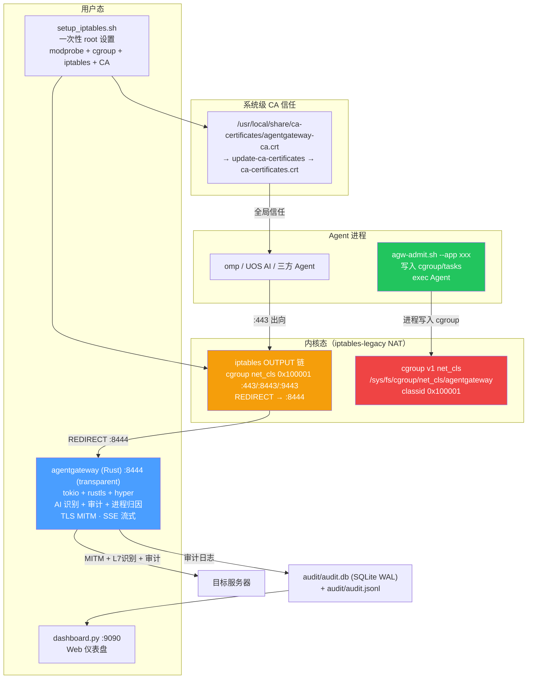

# AgentGateway

透明代理 + AI 请求审计 + 工具调用追踪 + 可视化仪表盘。

AgentGateway 通过 iptables REDIRECT + cgroup net_cls 进程级隔离，零改造拦截 agw-admit 纳入的 Agent 进程的所有 HTTPS 请求，对 AI 请求进行**审计记录并转发**（不阻断），捕获请求/响应内容、token 用量、工具调用链，并通过 Web 仪表盘实时展示。

代理层基于 **Rust (tokio + rustls + hyper)**，异步多线程、内存可控（< 50MB），支持 TLS MITM、SSE 流式响应。审计存储使用 **SQLite WAL** 模式，Dashboard 通过 SQL 查询（无需全量读取），彻底解决了 mitmproxy 线程泄漏 + JSONL 全量读取导致的 22GB 内存泄漏问题。

## 架构



### 工作原理

1. **agw-admit** 将 Agent 进程写入 cgroup `net_cls/agentgateway`（classid 0x100001）
2. Agent 发起 HTTPS → iptables OUTPUT 链匹配 cgroup classid → REDIRECT 到 :8444
3. agentgateway (Rust) 收到连接 → `SO_ORIGINAL_DST` 获取原始目标 → MITM TLS
4. HTTP 解析 → `detect_ai_request()` L7 识别（路径/认证头/请求体信号）
5. AI 请求审计记录到 `audit/audit.db` (SQLite WAL) + `audit/audit.jsonl` 备份 → 原样转发
6. 非 AI 请求直接转发（仍经 MITM TLS，但无审计）
7. Dashboard 通过 SQL 查询 SQLite，在 `http://127.0.0.1:9090` 展示
8. 浏览器/邮件/其他进程的 :443 流量不匹配 cgroup 规则 → 直连，零开销

### 关键设计原则

- **审计而非阻断**：AI 请求被记录后正常转发，Agent 功能不受影响
- **按进程拦截**：只有 agw-admit 纳入 cgroup 的进程的 :443 流量被重定向，其他所有进程（浏览器、邮件、应用商店）零影响
- **Agent 零改造**：不设任何环境变量，不需要修改代码，不需要特殊启动参数
- **不可绕过**：iptables NAT 在内核态重定向，Agent 无法绕过
- **完整协议支持**：基于 Rust rustls + hyper，支持 TLS MITM、HTTP/1.1、SSE 流式响应
- **低内存**：Rust 异步代理（< 50MB RSS），SQLite WAL 审计存储 + SQL 查询 Dashboard（~20MB），彻底解决 mitmproxy 线程泄漏问题

## 目录结构

agentgateway/
├── src/                        # Rust 代理源码
│   ├── main.rs                 # 入口：clap 参数、tokio main、监听循环、单元测试
│   ├── proxy.rs                # 透明代理核心（SO_ORIGINAL_DST、blind tunnel、TLS MITM）
│   ├── tls.rs                  # TLS MITM（Certifier 缓存 + InsecureVerifier）
│   ├── ca.rs                   # CA 证书加载/生成（rcgen 动态叶子证书）
│   ├── http_mitm.rs            # HTTP/1.1 解析与转发（Content-Length + chunked）
│   ├── detect.rs               # AI 请求识别（路径/认证头/请求体信号）
│   ├── attribution.rs          # 进程归因（/proc/net/tcp + /proc/*/fd + 父进程链）
│   └── audit.rs                # SQLite WAL + JSONL 双写审计
├── Cargo.toml                  # Rust 依赖配置
├── dashboard/
│   ├── dashboard.py            # Web 仪表盘（SQL 查询 SQLite）
│   └── dashboard_template.html
├── setup_iptables.sh           # 一次性 root 设置脚本
├── start.sh                    # 生命周期管理
├── agw-admit.sh                # Agent cgroup 纳入
├── specs/                      # 方案 spec
├── bpf/                        # BPF-LSM/uprobe 代码（6.6+ 内核未来扩展）
├── certs/                      # CA 证书（PKCS#8 格式）
├── audit/
│   ├── audit.db                # 审计日志（SQLite WAL）
│   └── audit.jsonl             # 审计日志（JSONL 备份）
├── logs/                       # 运行日志
└── docs/superpowers/plans/     # 实施计划
```

## 环境要求

| 依赖 | 版本 | 说明 | 必需 |
|------|------|------|------|
| Rust | ≥ 1.84 | 代理核心（tokio + rustls + hyper） | ✅ |
| Python | ≥ 3.7 | 仪表盘 | ✅ |
| iptables-legacy | 系统自带 | cgroup 匹配 + REDIRECT（4.19 默认安装） | ✅ |
| xt_cgroup.ko | 内核模块 | iptables cgroup 匹配（4.19 默认提供） | ✅ |
| root 权限 | 一次性 | modprobe + cgroup + iptables + CA 安装 | ✅ |
| certutil (nss-tools) | 任意 | 导入 CA 到浏览器 NSS 库 | ⬜ 可选 |

### 构建 Rust 代理

```bash
# 设置代理绕过（避免 cargo auto_proxy 干扰）
export no_proxy="*" NO_PROXY="*"
unset http_proxy https_proxy HTTP_PROXY HTTPS_PROXY

cargo build --release
# 产物：target/release/agentgateway（~8MB）
```

## 部署

### 1. 一次性 root 设置

```bash
cd agentgateway
./start.sh setup
# 或直接：sudo bash setup_iptables.sh
```

执行内容：
1. `modprobe xt_cgroup` — 加载 cgroup 匹配模块
2. 创建 `/sys/fs/cgroup/net_cls/agentgateway` cgroup（classid 0x100001）
3. `chmod 666 tasks` — 允许普通用户 agw-admit 写入
4. 加载 `certs/ca-cert.pem` + `certs/ca-key.pem`（PKCS#8 格式），若不存在则自动生成
5. 安装 AgentGateway CA 到 `/usr/local/share/ca-certificates/agentgateway-ca.crt` + `update-ca-certificates`（写入 `ca-certificates.crt` bundle）
6. 安装 CA 到 NSS DB（Chrome/Chromium 信任，删除旧 `AgentGateway Root CA`）
7. 设置 iptables-legacy REDIRECT 规则（:443 :8443 :9443 → :8444）

**验证**：
```bash
/usr/sbin/iptables-legacy -t nat -L OUTPUT -n
# 应看到：REDIRECT tcp dpt:443 to:8444
```

**清理**：
```bash
sudo bash setup_iptables.sh --cleanup
```

### 2. 证书信任链

AgentGateway 使用 `certs/ca-cert.pem` + `certs/ca-key.pem`（PKCS#8 格式）作为 CA。若不存在则自动生成。`./start.sh setup` 将此 CA 安装到系统信任库：

| 安装位置 | 用途 | 应用 |
|----------|------|------|
| `/usr/local/share/ca-certificates/agentgateway-ca.crt` → `update-ca-certificates` → `ca-certificates.crt` | OpenSSL / Qt / Python / curl / GnuTLS | uos-ai、omp、命令行工具 |
| NSS DB `~/.pki/nssdb`（nickname `agentgateway`） | Chrome / Chromium 浏览器 | 浏览器中的 AI 请求 |

> ⚠️ `update-ca-certificates` 只扫描 `/usr/local/share/ca-certificates/*.crt`，不扫描 `/etc/ssl/certs/`。CA 必须放到前者目录才能进入 `ca-certificates.crt` bundle。

如需手动安装：

```bash
# 系统 CA 库
sudo cp certs/ca-cert.pem /usr/local/share/ca-certificates/agentgateway-ca.crt
sudo update-ca-certificates

# NSS DB（浏览器）
certutil -d sql:$HOME/.pki/nssdb -A -t "C,," \
  -n "agentgateway" -i certs/ca-cert.pem

> 安装后需重启相关应用才能生效。

## 运行

### 启动透明代理 + 仪表盘

```bash
cd agentgateway
./start.sh start
```

| 命令 | 说明 |
|------|------|
| `./start.sh start` | 启动 Rust 代理 + 仪表盘（后台） |
| `./start.sh fg` | 前台运行（Ctrl+C 停止） |
| `./start.sh stop` | 停止两者 |
| `./start.sh restart` | 重启两者 |
| `./start.sh status` | 查看运行状态 |
| `./start.sh setup` | 一次性 root 设置 |

启动成功标志：
- `./start.sh status` 显示两者均为 `running`
- 浏览器打开 `http://127.0.0.1:9090` 显示仪表盘页面

### 通过 agw-admit 启动 Agent

```bash
# 基本用法
./agw-admit.sh --app "MyApp" <command> [args...]

# 示例：启动 omp
./agw-admit.sh --app "OMP" /home/ut000520@uos/.local/bin/omp

# 示例：启动 UOS AI
./agw-admit.sh --app "UOS-AI" /usr/bin/uos-ai-assistant

# 示例：启动 Python agent
./agw-admit.sh --app "MyAgent" python3 my_agent.py
```

agw-admit 将当前进程写入 cgroup `net_cls/agentgateway/tasks`，Agent 启动后其 :443 出向流量自动被 iptables 重定向到透明代理。Agent **零改造、零环境变量**。

**Agent 身份归因**：agw-admit 设置 `AGENTGATEWAY_APP_NAME`、`AGENTGATEWAY_AGENT_ID`、`AGENTGATEWAY_SESSION_ID` 环境变量。Rust 代理的 `attribution` 模块通过 `/proc/net/tcp` + `/proc/*/fd` 找到发起连接的进程，读取其环境变量中的 Agent 身份信息，写入审计日志。即使 Agent 通过 curl/python3 等工具进程发送请求，代理也能沿父进程链追溯到真正的 Agent 进程（如 omp），并从工具进程的环境变量中获取 agw-admit 设置的身份信息。

### 验证拦截

```bash
# 用 agw-admit 启动 curl 发送 AI 请求
./agw-admit.sh --app "TestApp" curl -sS \
  --cacert certs/ca-cert.pem \
  -X POST https://ai.uniontech.com/v1/chat/completions \
  -H 'Content-Type: application/json' \
  -H 'Authorization: Bearer test-key' \
  -d '{"model":"glm-5","messages":[{"role":"user","content":"hello"}]}'

# 查看审计日志
tail -f audit/audit.jsonl | python3 -m json.tool

# 访问仪表盘
# http://127.0.0.1:9090
```

## 仪表盘

打开 `http://127.0.0.1:9090` 查看仪表盘。

### 功能页面

| 页面 | 说明 |
|------|------|
| 📊 概览 | 总事件数、拦截/放行/审计统计、请求时间线、模型分布、主机统计 |
| 📋 请求 | AI 请求列表（时间、应用、方法、主机、模型、状态、延迟、token、预览） |
| 🔗 跟踪 | 按对话分组的 AI 请求时间线，展开显示工具调用链 |

### API 端点

| 端点 | 说明 |
|------|------|
| `GET /api/data` | 统计 + 请求列表（200条）+ 跟踪列表（50条） |
| `GET /api/refresh` | 统计 + 最近拦截/放行/审计事件 |
| `GET /api/events` | 统计 + 拦截/审计/放行事件列表 |

## 审计日志格式

`audit/audit.jsonl` 每行一个 JSON 事件，主要字段：

```jsonc
{
  "ts": "2026-11-25T03:30:00.000000+00:00",  // UTC 时间戳
  "event": "ai_request_audited",              // 事件类型
  "decision": "AUDIT",                        // 决策：AUDIT
  "agent_id": "agent-def456",                 // Agent ID（agw-admit 设置）
  "session_id": "session-abc123",             // 会话 ID（agw-admit 设置）
  "app_name": "OMP",                          // 应用名（agw-admit --app 设置）
  "method": "POST",                           // HTTP 方法
  "host": "ai.uniontech.com",                 // 目标主机
  "path": "/v1/chat/completions",            // 请求路径
  "model": "glm-5",                          // AI 模型
  "confidence": 6,                            // AI 识别置信度
  "request_body": {...},                      // 请求体（含 messages、tools 等）
  "stream_mode": true,                        // 是否流式请求
  "source": "rust_proxy"                      // 来源
}
```

### Rust 代理配置（`start.sh` → `proxy_cmd()`）

| 配置项 | 默认值 | 说明 |
|--------|--------|------|
| `--host` | `127.0.0.1` | 监听地址 |
| `--port` | `8444` | iptables REDIRECT 目标端口 |
| CA 证书 | `certs/ca-cert.pem` | 自动加载，不存在则生成 |
| CA 密钥 | `certs/ca-key.pem` | PKCS#8 格式 |
| 审计 DB | `audit/audit.db` | SQLite WAL 模式 |
| JSONL 备份 | `audit/audit.jsonl` | 审计日志 JSONL 备份 |
| 上游证书验证 | 不验证 | 对应 mitmproxy `ssl_insecure=true` |

### AI 识别配置（`src/detect.rs`）

| 配置项 | 默认值 | 说明 |
|--------|--------|------|
| `AI_API_PATHS` | `/v1/chat/completions` 等 | AI API 路径模式 |
| `AI_AUTH_HEADERS` | `authorization`, `x-api-key` 等 | AI 认证头 |
### iptables 规则


```bash
# 重定向 cgroup 0x100001 进程的 :443/:8443/:9443 到 :8444
for port in 443 8443 9443; do
  /usr/sbin/iptables-legacy -t nat -A OUTPUT \
    -p tcp --dport $port -m cgroup --cgroup 0x100001 \
    -j REDIRECT --to-port 8444
done
```

### cgroup 配置

```bash
# cgroup 路径
/sys/fs/cgroup/net_cls/agentgateway/

# classid
echo 0x100001 > /sys/fs/cgroup/net_cls/agentgateway/net_cls.classid

# 允许普通用户写入（agw-admit 使用）
chmod 666 /sys/fs/cgroup/net_cls/agentgateway/tasks
```

## 停止服务

```bash
./start.sh stop

# 清理 iptables 规则（可选）
sudo bash setup_iptables.sh --cleanup
```

## 已知限制

| 限制 | 影响 | 缓解 |
|---|---|---|
| 需 root 设置 iptables | 一次性操作 | `./start.sh setup` |
| agw-admit 写 cgroup/tasks 需权限 | `chmod 666 tasks` 解决 | setup 脚本自动设置 |
| cgroup v1 net_cls 已弃用 | 4.19 仍完全支持 | 6.6+ 可迁移到 cgroup v2 + BPF |
| 无文件管控 | 无法限制文件读写 | 需 6.6+ BPF-LSM |
| 无自保护 | Agent 可杀网关进程 | 需 6.6+ BPF-LSM security_bpf |
| cert pinning 应用 | 不信任系统 CA | 需 6.6+ BPF uprobe 取明文 |
| HTTP/2 上游 | 当前仅支持 HTTP/1.1 上游连接 | 大多数 AI API 支持 HTTP/1.1 |

## 技术方案文档

- [`specs/方案A_透明代理进程级拦截_4.19内核.md`](specs/方案A_透明代理进程级拦截_4.19内核.md) — 透明代理进程级拦截方案（当前实现，适用于 4.19 内核）
- [`specs/方案B_BPF-LSM内核级管控_6.6内核.md`](specs/方案B_BPF-LSM内核级管控_6.6内核.md) — BPF-LSM 内核级管控方案（V25，含文件访问管控，适用于 6.6+ 内核）

## 开源许可

本项目基于 [Apache License 2.0](LICENSE) 开源。

Copyright (c) 2026 Uniontech Software Technology Co., Ltd.

除非适用法律要求或书面同意，根据许可证分发的软件按"原样"分发，
不附带任何明示或暗示的担保或条件。详见许可证全文。
