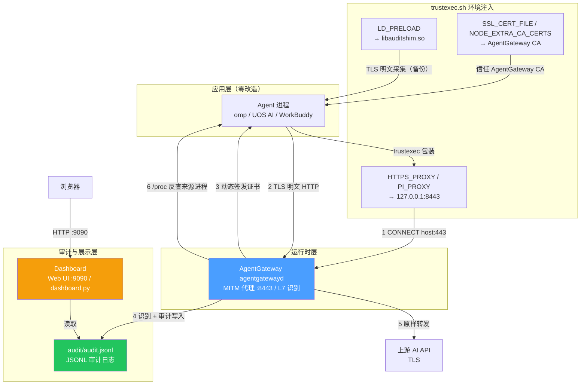

# 方案 A：用户态验证方案（4.19 内核 / 无 root）

> **Spec ID**: AGW-SPEC-A
> **适用平台**: Linux 4.19 内核，无 root 权限
> **验证状态**: ✅ 已在本机验证通过（6/6 单元测试 + omp/UOS AI 拦截测试）
> **定位**: 方案 B BPF-LSM 的用户态子集，用于在受限环境验证核心拦截能力

---

## 1. 设计目标

在无 root、4.19 内核环境下，零改造拦截 omp（Bun）、UOS AI（Qt5）、WorkBuddy（Electron）等 Agent 的所有 AI 模型 API 请求，记录请求/响应内容与工具调用链，并通过 Web 仪表盘实时展示。

**核心原则**：**审计而非阻断**——AI 请求被记录后正常转发，Agent 功能不受影响。

## 2. 架构



### 数据流说明

1. Agent 通过环境变量将 HTTPS 流量指向网关（标准 `HTTPS_PROXY` 或 omp 专用 `PI_PROXY`）
2. 网关对 AI 主机执行 MITM TLS（动态签发证书），对非 AI 主机盲隧道转发
3. 网关解密 AI 请求，记录到 `audit/audit.jsonl`，然后**原样转发**（不阻断）
4. 网关通过 `/proc/net/tcp` + `/proc/*/fd/` 反查连接来源进程，沿父进程链找到真正 Agent
5. Dashboard 读取审计日志，在 `http://127.0.0.1:9090` 展示实时统计、请求列表、对话跟踪

## 3. 核心组件

### 3.1 透明代理 (agentgatewayd.py)

| 属性 | 值 |
|---|---|
| 技术栈 | Python 3.8+ stdlib + cryptography ≥ 2.6 |
| 监听 | 127.0.0.1:8443 (HTTP CONNECT 代理) |
| 线程模型 | ThreadingHTTPServer (每连接一线程) |
| 证书签发 | 动态生成 per-host TLS 证书，AgentGateway CA 签名 |
| 证书缓存 | 内存 dict (hostname → cert_path) + 磁盘 `certs/dyn-*.pem` |
| 密钥复用 | 一个 RSA 2048 密钥对用于所有动态证书 |

**CONNECT 处理流程**:
1. 收到 `CONNECT host:443` → 回复 `200 Connection Established`
2. `_should_mitm(host)` 判断是否为 AI 主机（匹配 `AI_HOST_PATTERNS`）
3. AI 主机 → 动态生成 TLS 证书（SAN 包含 hostname），与 Agent 建立 TLS → 读取明文 HTTP
4. 非 AI 主机 → 盲隧道（直接转发 TCP，不解密）
5. 明文请求经 `detect_ai_request()` L7 识别 → AUDIT 后转发

### 3.2 MITM 拦截范围

`_should_mitm(host)` 对以下 AI API 主机执行 MITM TLS，其余主机盲隧道：

```
ai.uniontech.com, api.openai.com, api.anthropic.com, api.deepseek.com,
api.moonshot.cn, dashscope.aliyuncs.com, api.minimax.chat,
api.lingyiwanwu.com, api.groq.com, api.together.xyz, api.mistral.ai,
generativelanguage.googleapis.com, aip.baidubce.com
```

### 3.3 L7 AI 请求识别器

**识别信号**:

| 信号类型 | 匹配模式 | 权重 |
|---|---|---|
| path_match | `/v1/chat/completions`, `/v1/messages`, `/v1/embeddings`, `/v1/responses`, `/v1/completions`, `/chat/completions`, `/api/v1/chat`, `/api/chat`, `/v1/models` | +2 |
| auth_header | `Authorization: Bearer ...`, `x-api-key`, `anthropic-version`, `x-goog-api-key` | +1 |
| body:messages[] | JSON body 含 `messages` 数组 | +2 |
| body:prompt | JSON body 含 `prompt` 字段 | +2 |
| body:model | JSON body 含 `model` 字段 | +1 |
| body:max_tokens | JSON body 含 `max_tokens` | +1 |
| body:temperature | JSON body 含 `temperature` | +1 |
| body:stream | JSON body 含 `stream` | +1 |

**决策规则**: 置信度 ≥ 3 **或** 信号数 ≥ 2 → AI 请求 → **AUDIT（记录后转发）**

> **注意**：当前实现为**审计而非阻断**。AI 请求被完整记录到审计日志后原样转发到真实目标，Agent 功能不受影响。响应注入 `X-AgentGateway-Decision: AUDIT` 头标记。

**支持厂商**: OpenAI, Anthropic, DeepSeek, 通义千问, Google Gemini, MiniMax, 零一万物, Groq, Mistral, 百度文心

### 3.4 应用自动识别

网关通过**进程名**自动识别应用来源，无需维护关键词列表：

**识别流程** (`_lookup_peer_process()` + `_resolve_agent_process()`):
1. `getpeername()` + `getsockname()` 获取客户端→网关连接信息
2. 扫描 `/proc/net/tcp` 找到客户端侧 socket 的 inode
3. 扫描 `/proc/*/fd/` 找到持有该 socket 的进程 PID（跳过网关自身）
4. 沿父进程链向上遍历（`/proc/<pid>/status` → `PPid`），跳过工具进程
5. 第一个非工具进程的 `/proc/<pid>/comm` 即为 app_name

**工具进程列表** (`_TOOL_PROCESSES`): curl, wget, python*, node, bun, bash, sh, zsh, env, nohup, timeout, xargs 等

**识别示例**:
- `curl → omp → zsh → deepin-terminal` → app_name = `omp`
- `python3 → omp → zsh` → app_name = `omp`
- `uos-ai-assistant`（直接连接） → app_name = `uos-ai-assistant`

**进程缓存**: 30 秒 TTL（`_proc_cache`），以客户端端口为 key，避免重复扫描 `/proc`。

### 3.5 omp（Bun）代理机制

omp 是 Bun 编译的二进制，有三层代理代码路径，需特殊处理：

| 机制 | 环境变量 | 作用 |
|---|---|---|
| 全局 fetch 包装器 | `PI_PROXY` | omp 的 `K$t()` 函数检查此变量，未设置则 `fetch()` 不走代理 |
| Per-Provider 解析 | `PI_PROXY_<PROVIDER>` / `HTTPS_PROXY` / `ALL_PROXY` | `Uy()` 函数按优先级解析代理 |
| Node.js 兼容层 | `NODE_USE_ENV_PROXY=1` | `http.Agent` 读取 `HTTPS_PROXY` 的开关 |

**关键**：必须设置 `PI_PROXY`，否则 omp 的 `fetch()` 直接连接目标服务器，忽略 `HTTPS_PROXY`。

**omp daemon 清理**：omp 使用持久 daemon 架构，daemon 继承创建它的会话的环境变量。trustexec.sh 在启动 omp 前先杀掉旧 daemon（`pkill -f "omp __omp_worker_daemon"`），确保新 daemon 继承代理环境变量。

### 3.6 trustexec 包装器

**注入环境变量**:

| 环境变量 | 值 | 作用 |
|---|---|---|
| `HTTPS_PROXY` / `HTTP_PROXY` | `http://127.0.0.1:8443` | 标准 HTTPS 代理（含小写版本） |
| `NO_PROXY` | `localhost,127.0.0.1` | 排除本地回环 |
| `PI_PROXY` | `http://127.0.0.1:8443` | omp/Bun 专用代理变量 |
| `NODE_USE_ENV_PROXY` | `1` | Node.js 兼容层代理开关 |
| `SSL_CERT_FILE` | `certs/ca-cert.pem` | OpenSSL/Qt 信任 CA |
| `NODE_EXTRA_CA_CERTS` | `certs/ca-cert.pem` | Electron/Node 信任 CA |
| `REQUESTS_CA_BUNDLE` | `certs/ca-cert.pem` | Python requests 信任 CA |
| `AGENTGATEWAY_AGENT_ID` | `agent-<uuid>` | 进程身份标识 |
| `AGENTGATEWAY_SESSION_ID` | `session-<uuid>` | 会话身份标识 |
| `LD_PRELOAD` | `libauditshim.so` | TLS 明文采集（存在时设置） |

**特殊处理**:
- `unset auto_proxy`：DDE PAC 文件会使 Node/undici 绕过 `HTTPS_PROXY`
- `unset NODE_TLS_REJECT_UNAUTHORIZED`：用 CA 证书信任替代禁用验证（更安全）
- omp 启动前杀旧 daemon
- `gsettings` 强制 DDE 系统代理为 manual 模式（UOS AI/omp 读取此设置）

### 3.7 LD_PRELOAD TLS Audit Shim

| 钩子函数 | TLS 库 | 覆盖的 Agent |
|---|---|---|
| `SSL_CTX_set_verify` / `SSL_CTX_ctrl` / `SSL_set_verify` | OpenSSL | 强制 `SSL_VERIFY_NONE` |
| `X509_verify_cert` | OpenSSL | 始终返回 1（Qt5 证书链绕过） |
| `SSL_write` / `SSL_read` | OpenSSL 1.1/3.x | Python Agent, UOS AI |
| `gnutls_record_send` / `gnutls_record_recv` | GnuTLS | WorkBuddy |

**构建**: `gcc -shared -fPIC -o gateway/libauditshim.so gateway/libauditshim.c -ldl`

> 现代 glibc（2.34+）已将 pthread 合入 libc，`-ldl` 即可。旧系统追加 `-lpthread`。

**输出**: Unix domain socket (`/tmp/agentgateway-audit.sock`)，非阻塞 best-effort。

### 3.8 审计日志

**格式**: JSONL（每行一个 JSON 事件，线程安全，line-buffered）

**事件 Schema**（实际实现）:
```json
{
  "ts": "2026-11-24T07:20:37.000000+00:00",
  "ts_unix": 1795504837.0,
  "agent_id": "agent-7cb2e723",
  "app_name": "omp",
  "peer_pid": 52938,
  "peer_comm": "omp",
  "session_id": "session-43489a87",
  "request_id": "req-7887dee2ec35",
  "event": "ai_request_audited",
  "method": "POST",
  "host": "ai.uniontech.com",
  "port": 443,
  "path": "/v1/chat/completions",
  "model": "glm-5",
  "confidence": 6,
  "signals": ["path_match:/v1/chat/completions", "auth_header:Authorization", "body:messages[]", "body:model"],
  "prompt_len": 127,
  "preview": "hello",
  "request_headers": {"Authorization": "Bearer ***REDACTED***"},
  "request_body": {"model": "glm-5", "messages": [...]},
  "stream_mode": false,
  "response_status": 200,
  "response_headers": {...},
  "response_body": {...},
  "token_usage": {"total_tokens": 1234},
  "latency_ms": 8658,
  "decision": "AUDIT",
  "summary": "AI request audited & forwarded: POST ai.uniontech.com/v1/chat/completions model=glm-5"
}
```

**事件类型**: `ai_request_audited`（请求审计）、`ai_response`（响应审计）、`ai_forward_error`（转发失败）

**脱敏**: `Authorization` / `x-api-key` / `Cookie` 等敏感头自动截断为前 20 字符 + `***REDACTED***`

### 3.9 Web 仪表盘

| 属性 | 值 |
|---|---|
| 技术栈 | Python stdlib `http.server` + Chart.js (CDN) |
| 监听 | 127.0.0.1:9090 |
| 数据源 | 读取 `audit/audit.jsonl`（无数据库） |
| 时区 | 审计日志 UTC，前端转换为本地时区（UTC+8） |

**页面**: 概览（统计+时间线+模型分布）、请求列表（时间/应用/模型/状态/延迟/token）、对话跟踪（按对话分组的时间线+工具调用链）

**API 端点**: `GET /api/data`（统计+请求200条+跟踪50条）、`GET /api/refresh`（统计+最近事件）、`GET /api/events`（事件列表）

## 4. 验证结果

### 4.1 网关单元测试 (6/6 通过)

| 测试 | 方法 | 目标 | 路径 | 期望 | 实际 | 结果 |
|---|---|---|---|---|---|---|
| 1 | POST | api.openai.com | /v1/chat/completions | AUDIT | AUDIT (转发) | ✅ |
| 2 | POST | api.anthropic.com | /v1/messages | AUDIT | AUDIT (转发) | ✅ |
| 3 | POST | api.openai.com | /v1/embeddings | AUDIT | AUDIT (转发) | ✅ |
| 4 | POST | api.deepseek.com | /v1/chat/completions (stream) | AUDIT | AUDIT (转发) | ✅ |
| 5 | POST | dashscope.aliyuncs.com | /api/v1/services/aigc/... | AUDIT | AUDIT (转发) | ✅ |
| 6 | GET | example.com | / | FORWARD | FORWARDED (200) | ✅ |

> 测试验证 AI 请求被**审计记录后转发**（`X-AgentGateway-Decision: AUDIT`），非 AI 请求盲隧道转发（无决策头）。

### 4.2 实机拦截验证

| Agent | 启动方式 | 结果 |
|---|---|---|
| omp (Bun) | `trustexec.sh --app OMP omp` | AI 请求审计 ✅，进程识别 `app_name=omp` ✅ |
| UOS AI (Qt5) | `trustexec.sh` + gsettings manual | AI 请求审计 ✅，LD_PRELOAD 绕过 TLS ✅ |
| curl 测试 | `curl -x http://127.0.0.1:8443 ...` | `X-AgentGateway-Decision: AUDIT` ✅ |

### 4.3 审计日志验证

- 审计日志写入 `audit/audit.jsonl`，每请求产生 `ai_request_audited` + `ai_response` 两个事件
- `app_name` 通过父进程链正确解析（curl → omp → zsh → 识别为 omp）
- 敏感头自动脱敏
- 响应注入 `X-AgentGateway-Decision` / `X-AgentGateway-Confidence` / `X-AgentGateway-Request-Id` 头

## 5. 限制与诚实边界

| 限制 | 影响 | 方案 B 对策 |
|---|---|---|
| HTTPS_PROXY 可被绕过 | Agent 可不尊重环境变量 | nftables TPROXY + BPF-LSM socket_connect |
| 环境变量身份可篡改 | Agent 可伪造 agent_id | BPF task storage (内核内) |
| LD_PRELOAD 可被卸载 | Agent 可 dlopen 清除 shim | BPF uprobe CO-RE (内核内) |
| 无文件管控 | 无法限制文件读写 | BPF-LSM file_open + Landlock ABI v3 |
| GUI 交互未自动化 | 测试用模拟流量 | 方案 B 验证时用真实交互 |
| 无自保护 | Agent 可杀网关进程 | BPF-LSM security_bpf |
| 快速连接识别失败 | 极快连接（curl 立即退出）可能识别不到进程 | 30 秒缓存缓解重复连接 |
| DDE 代理自动重置 | gsettings 可能被重置为 auto | 需监控脚本定期重置 |

## 6. 部署与运行

### 6.1 前置条件
- Python 3.8+ with `cryptography` 包
- GCC（编译 LD_PRELOAD shim，可选）
- 无需 root

### 6.2 启动步骤

```bash
cd agentgateway

# 1. 生成 CA 证书（首次）
python3 gateway/gen_ca.py

# 2. 编译 LD_PRELOAD shim（首次，可选但推荐）
gcc -shared -fPIC -o gateway/libauditshim.so gateway/libauditshim.c -ldl

# 3. 启动网关
mkdir -p logs
python3 gateway/agentgatewayd.py > logs/gateway.log 2>&1 &

# 4. 启动 Web 仪表盘
python3 dashboard/dashboard.py > logs/dashboard.log 2>&1 &

# 5. 验证端口监听
sleep 2 && ss -tlnp | grep -E '8443|9090'

# 6. 通过 trustexec 启动 Agent
./trustexec.sh --app OMP /home/ut000520@uos/.local/bin/omp
./trustexec.sh --app UOS-AI /usr/bin/uos-ai-assistant

# 7. 运行测试
python3 gateway/test_gateway.py
python3 test_agent_interception.py
```

### 6.3 验证拦截

```bash
# 发送测试 AI 请求
curl -s -x http://127.0.0.1:8443 \
  --cacert certs/ca-cert.pem \
  -X POST https://ai.uniontech.com/v1/chat/completions \
  -H "Content-Type: application/json" \
  -H "Authorization: Bearer test-key" \
  -d '{"model":"glm-5","messages":[{"role":"user","content":"hello"}]}' \
  -D - -o /dev/null -w "HTTP %{http_code}\n" | grep -i AgentGateway

# 预期：X-AgentGateway-Decision: AUDIT

# 查看审计日志最新条目
tail -2 audit/audit.jsonl | python3 -m json.tool
```

### 6.4 访问仪表盘
- Web UI: http://127.0.0.1:9090
- 审计日志: `audit/audit.jsonl`

### 6.5 停止服务

```bash
fuser -k 8443/tcp 2>/dev/null
fuser -k 9090/tcp 2>/dev/null
pkill -f "omp __omp_worker_daemon" 2>/dev/null
gsettings set org.gnome.system.proxy mode 'auto'
```

## 7. 文件清单

```
agentgateway/
├── gateway/
│   ├── agentgatewayd.py      # MITM 网关（核心）
│   ├── gen_ca.py             # CA 证书生成器
│   ├── test_gateway.py       # 网关单元测试
│   ├── libauditshim.c        # LD_PRELOAD TLS shim 源码
│   └── libauditshim.so       # 编译后的 shim
├── dashboard/
│   ├── dashboard.py          # Web 仪表盘（stdlib http.server）
│   └── dashboard_template.html  # 仪表盘前端模板
├── certs/
│   ├── ca-cert.pem           # AgentGateway Root CA
│   ├── ca-key.pem            # CA 私钥
│   └── dyn-*.pem             # 动态签发的主机证书
├── audit/
│   └── audit.jsonl           # 审计日志 (JSONL)
├── logs/
│   ├── gateway.log           # 网关运行日志
│   └── dashboard.log         # 仪表盘运行日志
├── specs/                    # 本文档所在目录
├── trustexec.sh              # Agent 包装器
└── test_agent_interception.py # Agent 拦截测试
```
