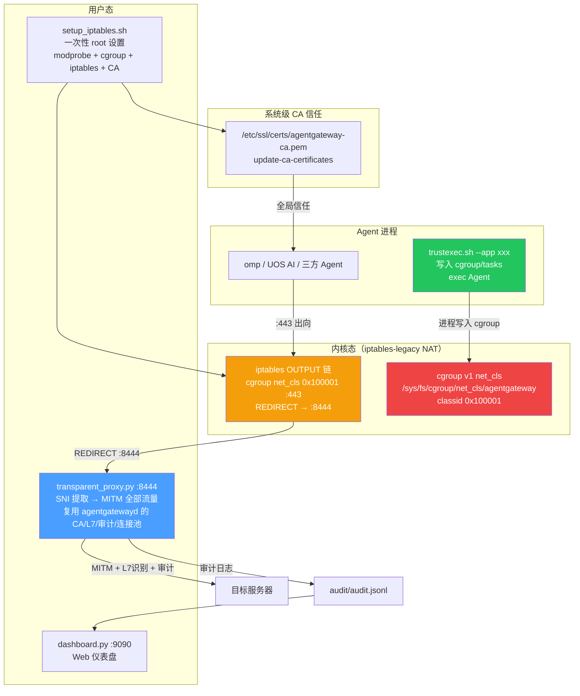

# 方案 A：透明代理进程级拦截方案（4.19 内核 / iptables + cgroup）

> **Spec ID**: AGW-SPEC-A
> **适用平台**: Linux 4.19 内核，iptables-legacy + cgroup v1 net_cls
> **定位**: 统一方案，替代历史环境注入实现。不再有方案A/B并存——本方案是唯一的网络请求拦截方案。

---

## 1. 设计目标

在 4.19 内核机器上，通过 iptables REDIRECT + cgroup net_cls 进程级隔离，零改造拦截 trustexec 纳入的 Agent 进程的所有 HTTPS 请求，记录请求/响应内容与调用链，并通过 Web 仪表盘实时展示。

**核心原则**：
- **审计而非阻断**——AI 请求被记录后正常转发，Agent 功能不受影响
- **按进程拦截**——只有 trustexec 纳入 cgroup 的进程的 :443 流量被重定向，其他所有进程（浏览器、邮件、应用商店）零影响
- **Agent 零改造**——不设任何环境变量，不需要修改代码，不需要特殊启动参数

## 2. 架构



### 数据流说明

1. **trustexec** 将 Agent 进程写入 cgroup `net_cls/agentgateway`（classid 0x100001）
2. Agent 发起 HTTPS → iptables OUTPUT 链匹配 cgroup classid → REDIRECT 到 :8444
3. transparent_proxy.py 收到连接 → `SO_ORIGINAL_DST` 获取原始目标 → MSG_PEEK 提取 SNI
4. 对全部流量执行 MITM TLS（动态签发证书）→ 读取明文 HTTP → `detect_ai_request()` L7 识别
5. AI 请求审计记录到 `audit/audit.jsonl` → 原样转发到真实目标
6. 非 AI 请求直接转发（仍经 MITM TLS，但无审计）
7. Dashboard 读取审计日志，在 `http://127.0.0.1:9090` 展示
8. 浏览器/邮件/其他进程的 :443 流量不匹配 cgroup 规则 → 直连，零开销

### 与旧方案的核心差异

| 维度 | 旧方案（环境注入） | 新方案（透明代理） |
|---|---|---|
| 拦截方式 | HTTPS_PROXY 环境变量 | iptables REDIRECT + cgroup net_cls |
| 进程隔离 | 无，所有走代理的流量 | 精确，只拦截 cgroup 内进程 |
| Agent 改造 | 需 trustexec 注入环境变量 | 零改造，只需 cgroup 纳入 |
| CA 信任 | 环境变量 SSL_CERT_FILE 等 | 系统级安装，全局信任 |
| TLS 明文采集 | LD_PRELOAD libauditshim.so | 不需要，透明代理直接 MITM |
| AI 主机识别 | AI_HOST_PATTERNS 列表 | 不需要，全部 MITM（cgroup 已隔离） |
| 非Agent影响 | gsettings 全局代理设置 | 零影响 |
| 可绕过性 | Agent 可不尊重环境变量 | 不可绕过（内核 NAT 重定向） |

## 3. 核心组件

### 3.1 cgroup net_cls 进程隔离

**原理**：cgroup v1 `net_cls` 子系统给 cgroup 内进程的套接字打上 classid 标记，iptables `-m cgroup` 匹配该标记。

**设置**（root 一次性）：
```bash
# 加载内核模块
modprobe xt_cgroup

# 创建 cgroup
mkdir -p /sys/fs/cgroup/net_cls/agentgateway
echo 0x100001 > /sys/fs/cgroup/net_cls/agentgateway/net_cls.classid

# 允许普通用户将进程写入 cgroup
chmod 666 /sys/fs/cgroup/net_cls/agentgateway/tasks
```

**iptables 规则**（root，使用 iptables-legacy）：
```bash
/usr/sbin/iptables-legacy -t nat -A OUTPUT \
  -p tcp --dport 443 \
  -m cgroup --cgroup 0x100001 \
  -j REDIRECT --to-port 8444
```

> **为什么用 iptables-legacy**：iptables-nft（默认）不支持 `-m cgroup` 和 `-m owner` 匹配。iptables-legacy 支持这两个模块（需 modprobe xt_cgroup）。4.19 内核的 xt_cgroup.ko 位于 `/lib/modules/4.19.0-amd64-desktop/kernel/net/netfilter/xt_cgroup.ko`。

**环路防止**：transparent_proxy.py 以 root 运行（root 不在 agentgateway cgroup 中），其出向 :443 连接不匹配 cgroup 规则，不会被重定向，避免死循环。

### 3.2 trustexec.sh（改造为 cgroup 纳入）

**旧行为**：注入 HTTPS_PROXY、SSL_CERT_FILE、LD_PRELOAD 等环境变量。

**新行为**：
1. 生成 agent_id / session_id（保留，用于审计归属）
2. 将当前 shell 写入 cgroup：`echo $$ > /sys/fs/cgroup/net_cls/agentgateway/tasks`
3. exec Agent 命令

**不再设置**：HTTPS_PROXY、HTTP_PROXY、PI_PROXY、SSL_CERT_FILE、REQUESTS_CA_BUNDLE、NODE_EXTRA_CA_CERTS、LD_PRELOAD、NODE_USE_ENV_PROXY、gsettings。

**Agent 身份传递**：trustexec 设置 `AGENTGATEWAY_AGENT_ID` 和 `AGENTGATEWAY_SESSION_ID` 环境变量，transparent_proxy.py 读取这些变量用于审计归属。

### 3.3 透明代理 (transparent_proxy.py)

| 属性 | 值 |
|---|---|
| 技术栈 | Python 3.8+ stdlib + cryptography ≥ 2.6 |
| 监听 | 127.0.0.1:8444（iptables REDIRECT 目标端口） |
| 线程模型 | 每连接一线程 (threading.Thread) |
| 原始目标获取 | `SO_ORIGINAL_DST` (sockopt 80, SOL_IP=0) |
| SNI 提取 | TLS ClientHello MSG_PEEK |
| 证书签发 | 复用 agentgatewayd.py 的 `generate_cert_for_host()` |
| L7 识别 | 复用 agentgatewayd.py 的 `detect_ai_request()` |
| 审计日志 | 复用 agentgatewayd.py 的 `audit_log()` |
| 连接池 | 复用 agentgatewayd.py 的 `_get_upstream_socket()` / `_return_upstream_socket()` |
| 盲隧道 | `select.poll()`（不用 `select.select()`，避免 FD 1024 限制） |

**处理流程**：
1. 接受连接 → `SO_ORIGINAL_DST` 获取原始目标 IP:port
2. `MSG_PEEK` 读取 TLS ClientHello → `extract_sni()` 提取 SNI
3. 有 SNI → 生成证书 → TLS 握手 → 读取明文 HTTP → L7 识别 → 审计 → 转发
4. 无 SNI → 盲隧道到原始目标（纯 TCP 转发）

**MITM 范围**：cgroup 隔离后，所有到达透明代理的流量都是 Agent 流量，**全部 MITM**，不再需要 `should_mitm()` / `AI_HOST_PATTERNS` 判断。

**需修复的问题**：

| 问题 | 当前代码 | 修复 |
|---|---|---|
| 函数名错误 | `gw._should_mitm(sni)` | 移除调用，全部 MITM |
| FD 限制崩溃 | `_blind_tunnel` 用 `select.select()` | 改用 `select.poll()` |
| 无连接池 | `_forward()` 每次新建 TLS 连接 | 复用 `gw._get_upstream_socket` / `_return_upstream_socket` |
| 无 keep-alive | `_forward()` 发 `Connection: close` | 改为 `keep-alive`，支持连接池 |
| chunked 读取 | `_forward()` 简单拼接 | 复用 agentgatewayd 的 chunked/content-length 读取逻辑 |

### 3.4 网关共享模块 (agentgatewayd.py)

transparent_proxy.py `import agentgatewayd as gw`，复用以下函数：

| 函数 | 作用 |
|---|---|
| `generate_cert_for_host(hostname)` | 动态生成 per-host TLS 证书 |
| `detect_ai_request(method, path, headers, body)` | L7 AI 请求识别 |
| `audit_log(event)` | 写入 audit.jsonl 审计日志 |
| `load_ca()` | 加载 CA 证书 |
| `audit_init()` | 初始化审计目录 |
| `log(msg)` | 日志输出 |
| `_get_upstream_socket(host, port)` | 获取上游 TLS 连接（连接池） |
| `_return_upstream_socket(host, port, sock)` | 归还连接到池 |
| `_dechunk(data)` | 解码 chunked 传输 |

**agentgatewayd.py 的 CONNECT 代理路径**（:8443）：保留但不再是主用路径。透明代理取代它作为默认拦截方式。`AI_HOST_PATTERNS` / `should_mitm()` 保留供 CONNECT 代理路径使用，透明代理不再调用。

### 3.5 系统级 CA 安装

**一次性安装**（root）：
```bash
cp certs/ca-cert.pem /etc/ssl/certs/agentgateway-ca.pem
update-ca-certificates
```

安装后，所有应用（Qt/Node/Python/curl/OpenSSL/GnuTLS）自动信任 AgentGateway CA，不需要：
- `SSL_CERT_FILE` / `REQUESTS_CA_BUNDLE` / `NODE_EXTRA_CA_CERTS` 环境变量
- `LD_PRELOAD libauditshim.so` 证书验证绕过
- `gsettings` 系统代理设置

**NSS DB**（Chrome/Chromium 浏览器）：
```bash
certutil -d sql:$HOME/.pki/nssdb -A -t "C,," \
  -n "AgentGateway Root CA" -i certs/ca-cert.pem
```

### 3.6 setup_iptables.sh（新建）

一次性 root 设置脚本，执行：
1. `modprobe xt_cgroup` — 加载 cgroup 匹配模块
2. 创建 `/sys/fs/cgroup/net_cls/agentgateway` cgroup
3. 设置 classid `0x100001`
4. `chmod 666 tasks` — 允许普通用户写入
5. 安装系统级 CA
6. 设置 iptables-legacy REDIRECT 规则

**清理**：
```bash
/usr/sbin/iptables-legacy -t nat -D OUTPUT \
  -p tcp --dport 443 \
  -m cgroup --cgroup 0x100001 \
  -j REDIRECT --to-port 8444
```

### 3.7 start.sh（扩展）

```bash
./start.sh start      # 启动透明代理 + dashboard
./start.sh stop       # 停止 + 清理 iptables 规则（如果有 root）
./start.sh status     # 显示状态
./start.sh setup      # 一次性设置（需 root，提示输入密码）
```

start.sh 启动时检测：
- iptables 规则是否已设置 → 未设置则提示运行 `./start.sh setup`
- 系统级 CA 是否已安装 → 未安装则提示运行 `./start.sh setup`
- 透明代理是否在运行 → 未运行则启动

### 3.8 审计日志

**格式**：JSONL（每行一个 JSON 事件，线程安全，line-buffered）

**事件 Schema**：
```json
{
  "ts": "2026-11-24T07:20:37.000000+00:00",
  "ts_unix": 1795504837.0,
  "agent_id": "agent-7cb2e723",
  "app_name": "omp",
  "session_id": "session-43489a87",
  "request_id": "req-7887dee2ec35",
  "event": "ai_request_audited",
  "method": "POST",
  "host": "ai.uniontech.com",
  "port": 443,
  "path": "/v1/chat/completions",
  "model": "glm-5",
  "confidence": 6,
  "signals": ["path_match:/v1/chat/completions", "auth_header:Authorization", "body:messages[]", "body:model"],
  "prompt_len": 127,
  "preview": "hello",
  "request_headers": {"Authorization": "Bearer ***REDACTED***"},
  "request_body": {"model": "glm-5", "messages": [...]},
  "stream_mode": false,
  "response_status": 200,
  "response_headers": {...},
  "response_body": {...},
  "token_usage": {"total_tokens": 1234},
  "latency_ms": 8658,
  "decision": "AUDIT",
  "source": "transparent_proxy",
  "summary": "AI request audited & forwarded: POST ai.uniontech.com/v1/chat/completions model=glm-5"
}
```

**脱敏**：`Authorization` / `x-api-key` / `Cookie` 等敏感头自动截断为前 20 字符 + `***REDACTED***`

### 3.9 Web 仪表盘 (dashboard.py)

| 属性 | 值 |
|---|---|
| 技术栈 | Python stdlib `http.server` + Chart.js (CDN) |
| 监听 | 127.0.0.1:9090 |
| 数据源 | 读取 `audit/audit.jsonl`（无数据库） |
| 时区 | 审计日志 UTC，前端转换为本地时区 |

## 4. 废弃组件

| 组件 | 状态 | 原因 |
|---|---|---|
| `trustexec.sh` 环境注入逻辑 | **改造** | 从环境注入改为 cgroup 纳入 |
| `gateway/libauditshim.c` / `.so` | **已删除** | 系统级 CA 后不需要 LD_PRELOAD 绕过验证 |
| `agentgatewayd.py` gsettings 代理管理 | **已删除** | 不再需要系统代理设置 |
| `agentgatewayd.py` CONNECT 代理路径 | **保留但降级** | 作为 fallback，不再是主用路径 |
| `AI_HOST_PATTERNS` / `should_mitm()` | **保留** | 供 CONNECT 代理路径使用，透明代理不调用 |
| `specs/方案A_用户态验证_4.19内核.md` | **已删除** | 被本 spec 替代 |
| `gateway/test_gateway.py` | **已删除** | 测试旧 CONNECT 代理 :8443 + HTTPS_PROXY 环境注入，不再适用 |
| `test_agent_interception.py` | **已删除** | 同上 |
| `run_agentgateway.sh` | **已删除** | 方案B 一键脚本，6.6 内核环境扩展，4.19 不使用 |
| `verify_install_deploy.sh` | **已删除** | DEB 包 + 方案B 验证脚本，不再适用 |
| `verify_planb_intercept.sh` | **已删除** | 方案B 验证脚本，不再适用 |
| `packaging/` | **已删除** | BPF-LSM systemd 服务 DEB 打包，4.19 不使用 |
| `specs/方案B_BPF-LSM内核级管控_6.6内核.md` | **保留** | V25 6.6 内核文件访问管控方案，作为未来扩展参考 |
| `bpf/` 目录（BPF-LSM/uprobe/seccomp） | **保留** | 6.6 内核环境的未来扩展基础，不影响 4.19 运行 |

## 5. 部署与运行

### 5.1 前置条件
- Python 3.8+ with `cryptography` 包
- root 权限（一次性设置：modprobe + cgroup + iptables + CA）
- iptables-legacy（4.19 默认安装）
- xt_cgroup.ko 内核模块（4.19 默认提供）

### 5.2 一次性设置

```bash
cd agentgateway

# 1. 生成 CA 证书（首次）
python3 gateway/gen_ca.py

# 2. 一次性 root 设置（modprobe + cgroup + iptables + CA）
./start.sh setup
# 或手动：sudo bash setup_iptables.sh
```

### 5.3 启动服务

```bash
# 启动透明代理 + 仪表盘
./start.sh start

# 验证端口
ss -tlnp | grep -E '8444|9090'
```

### 5.4 启动 Agent

```bash
# 通过 trustexec 纳入 cgroup
./trustexec.sh --app OMP /home/ut000520@uos/.local/bin/omp
./trustexec.sh --app UOS-AI /usr/bin/uos-ai-assistant
```

### 5.5 验证拦截

```bash
# 查看审计日志
tail -f audit/audit.jsonl | python3 -m json.tool

# 访问仪表盘
# http://127.0.0.1:9090
```

### 5.6 停止服务

```bash
./start.sh stop
```

## 6. 限制与诚实边界

| 限制 | 影响 | 缓解 |
|---|---|---|
| 需 root 设置 iptables | 一次性操作 | setup 脚本 + askpass |
| trustexec 写 cgroup/tasks 需权限 | chmod 666 tasks 解决 | setup 脚本设置权限 |
| cgroup v1 net_cls 已弃用 | 4.19 仍完全支持 | 6.6+ 可迁移到 cgroup v2 + BPF |
| 无文件管控 | 无法限制文件读写 | 需 6.6+ BPF-LSM |
| 无自保护 | Agent 可杀网关进程 | 需 6.6+ BPF-LSM security_bpf |
| cert pinning 应用 | 不信任系统 CA | 需 6.6+ BPF uprobe 取明文 |

## 7. 文件清单

```
agentgateway/
├── gateway/
│   ├── agentgatewayd.py       # 网关共享模块（CA/L7/审计/连接池）
│   ├── transparent_proxy.py   # 透明代理（iptables REDIRECT 目标）
│   └── gen_ca.py              # CA 证书生成器
├── dashboard/
│   ├── dashboard.py           # Web 仪表盘
│   └── dashboard_template.html
├── setup_iptables.sh          # 一次性 root 设置脚本
├── start.sh                   # 生命周期管理
├── trustexec.sh               # Agent cgroup 纳入
├── specs/
│   ├── 方案A_透明代理进程级拦截_4.19内核.md   # 本文档
│   └── 方案B_BPF-LSM内核级管控_6.6内核.md     # V25 未来扩展 spec
├── bpf/                       # BPF-LSM/uprobe 代码（6.6+ 内核未来扩展）
├── certs/                     # CA 证书 + 动态签发的主机证书
├── audit/
│   └── audit.jsonl            # 审计日志 (JSONL)
├── logs/                      # 运行日志
└── docs/superpowers/plans/    # 实施计划
```
