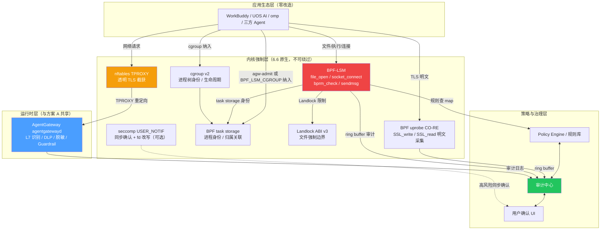
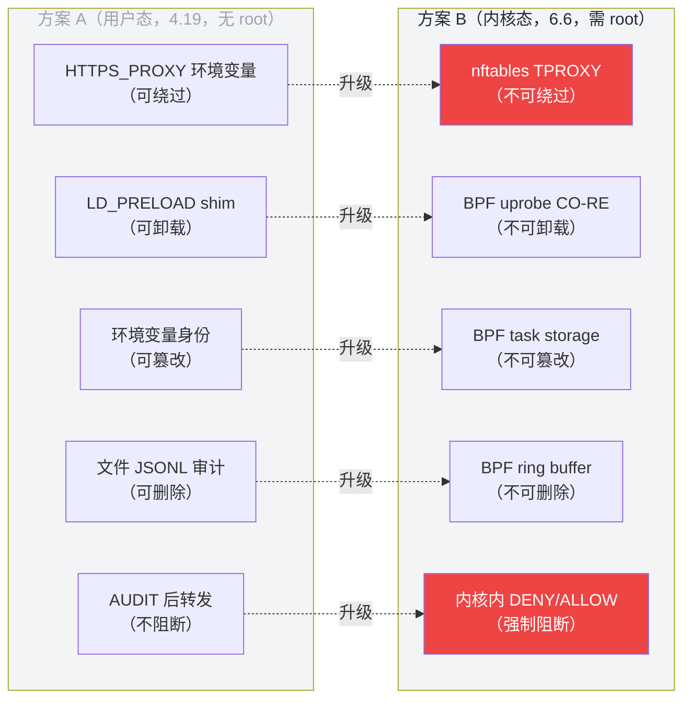
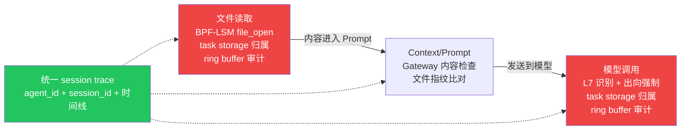
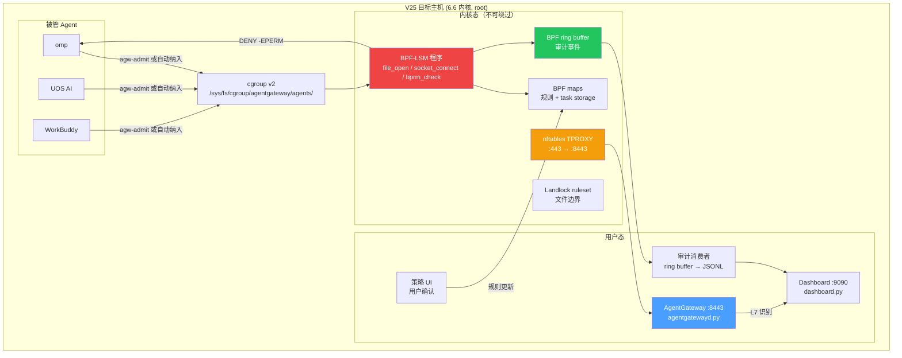

# 方案 B：BPF-LSM 内核级强制管控方案（V25 / 6.6 内核）

> **Spec ID**: AGW-SPEC-B
> **适用平台**: UOS V25 + Linux 6.6 LTS 内核，需 root (CAP_BPF + CAP_SYS_ADMIN)
> **验证状态**: ✅ P0-P5 已在本机（6.6.0-amd64-desktop）实施并验证通过；Landlock 不可用（内核未编译）改用 BPF-LSM `file_open`；P4 seccomp USER_NOTIF 核心已实现，NOTIF_ADDFD/FUSE/UI 待补
> **定位**: 生产级方案，内核内同步决策，不可被 Agent 绕过

---

## 1. 设计目标

在 V25 + 6.6 内核上，用 BPF-LSM 在内核安全检查点同步拦截 AI Agent 的文件读写、网络连接、程序执行，配合透明代理做 L7 内容识别，实现不可绕过的全链路管控。

**与方案 A 的核心差异**: 方案 A 在用户态（HTTPS_PROXY + LD_PRELOAD）审计后转发，可被绕过；方案 B 在内核态（BPF-LSM）强制决策，不可绕过。

## 2. 架构



### 方案 A → 方案 B 分层对比



## 3. 第一支柱：BPF-LSM 管控沙箱

### 3.1 BPF-LSM 替代用户态拦截

| 维度 | 方案 A (用户态) | 方案 B (BPF-LSM) |
|---|---|---|
| 拦截点 | HTTPS_PROXY 环境变量 | 内核安全检查点 (LSM hook) |
| 参数可见性 | HTTP 明文 | **内核对象** (file→path, socket→addr) |
| 决策位置 | 用户态网关进程 | **内核内 BPF 程序** |
| 决策类型 | AUDIT 后转发（不阻断） | **ALLOW / DENY / AUDIT / ASK_USER**（可阻断） |
| 用户态往返 | 每请求一次 (网关) | **零** (规则匹配在内核内) |
| 可绕过 | ✅ Agent 可不尊重 HTTPS_PROXY | **❌ 不可绕过** |

### 3.2 BPF-LSM hook 覆盖矩阵

6.6 内核源码 `kernel/bpf/bpf_lsm.c` 的 `sleepable_lsm_hooks` 集合确认：

| 管控类别 | BPF-LSM hook | sleepable | 能看到的内核对象 |
|---|---|---|---|
| 文件读取 | `security_file_open` | ✅ | `struct file *` → 路径、inode、f_flags |
| 文件写入 | `security_file_open` (检查 O_WRONLY/O_RDWR) | ✅ | 同上 |
| 文件创建 | `security_inode_create` | ✅ | `struct inode *` + dentry |
| 文件删除 | `security_inode_unlink` | ✅ | `struct inode *` + dentry |
| 程序执行 | `security_bprm_check` | ✅ | `struct linux_binprm *` → 可执行文件路径 |
| 网络连接 | `security_socket_connect` | ✅ | `struct socket *` + sockaddr (IP/端口) |
| 网络发送 | `security_socket_sendmsg` | ✅ | `struct socket *` + msghdr |
| mount 防护 | `security_sb_mount` | ✅ | dev_name + path + type + flags |

### 3.3 进程身份模型：BPF task storage

```
agw-admit 启动 Agent
  → bpf_task_storage_get(task, agent_map, BPF_LOCAL_STORAGE_GET_F_CREATE)
  → 写入: { agent_id, session_id, app_name, cgroup_id, start_time }
  → 子进程 fork 时 security_task_alloc hook → 自动复制 task storage
  → BPF-LSM 程序在每个 hook 点: bpf_task_storage_get → 获取 agent_id
  → 审计事件携带 agent_id → 归属关联完成
```

**与方案 A 的差异**: 方案 A 用环境变量（可篡改）；方案 B 用 BPF task storage（内核内，不可篡改）。

### 3.4 纳入机制：agw-admit + BPF_LSM_CGROUP

**路径 A: agw-admit 启动器（精确纳入）**
```
agw-admit --agent-id <uuid> --app <agent-app> [args...]
  1. 创建 cgroup v2: /sys/fs/cgroup/agentgateway/agents/<agent-id>
  2. echo $$ > cgroup.procs
  3. bpf_task_storage 写入 agent_id/session_id
  4. 安装 Landlock ruleset
  5. execve 真实程序
```

**路径 B: BPF_LSM_CGROUP attach（兜底纳入）**
```
BPF-LSM 程序 attach 到 /sys/fs/cgroup/agentgateway/agents/ cgroup
  → 任何进入此 cgroup 的进程自动受策略管控
  → 不依赖父子关系 (dbus/appmanager 中转启动也能管住)
  → 不需要 LD_PRELOAD
```

**互补**: agw-admit 精确注入身份 + Landlock；BPF_LSM_CGROUP 兜底防绕过。

### 3.5 决策模型

```
进程触发 LSM hook (如 security_file_open)
  → BPF-LSM 程序:
     1. bpf_task_storage_get → 获取 agent_id
     2. bpf_map_lookup_elem(rules_map, &key) → 查规则
     3. 规则匹配:
        ALLOW    → return 0 + bpf_ringbuf_output (审计)
        DENY     → return -EPERM + bpf_ringbuf_output (审计)
        AUDIT    → return 0 + bpf_ringbuf_output (审计)
        ASK_USER → return 0 (默认放行) + bpf_ringbuf_output (高优标记)
  → 用户态审计消费者收到 ASK_USER → 弹通知 → 用户决策 → 规则更新到 BPF map
```

**关键取舍**: ASK_USER 是异步的——BPF 默认放行，不阻塞。必须同步拦截的场景叠加 seccomp USER_NOTIF。

> **与方案 A 的区别**：方案 A 只能 AUDIT（记录后转发），无法 DENY；方案 B 可在内核内直接 `return -EPERM` 阻断。

### 3.6 规则 map 结构

```c
struct rule_key {
    u32 agent_id;
    u32 op_type;      // FILE_OPEN / SOCKET_CONNECT / BPRM_CHECK
    u32 object_hash;  // 路径哈希 / IP+端口哈希 / 二进制哈希
};

struct rule_value {
    u32 decision;     // ALLOW / DENY / AUDIT / ASK_USER
    u32 priority;
    u64 ttl_ns;
    u64 hit_count;
};
```

## 4. 第二支柱：AI Gateway 与透明代理

### 4.1 透明 TLS 截获（6.6 增强）

| 组件 | 方案 A (已实现) | 方案 B (6.6 待实现) |
|---|---|---|
| 网络重定向 | HTTPS_PROXY env var | **nftables TPROXY** (不可绕过) |
| 明文采集 | LD_PRELOAD shim | **BPF uprobe** (CO-RE, 不可卸载) |
| 网络兜底 | 无 | **BPF-LSM socket_connect** (内核内拒绝) |
| 系统级 CA | 环境变量注入 | **写入 /etc/ssl/certs/**（root 权限） |
| L7 识别 | agentgatewayd.py（复用） | agentgatewayd.py（复用，无需修改） |

> **当前状态**：方案 A 的 HTTPS_PROXY + 环境变量 CA 已验证通过。nftables TPROXY、系统级 CA 安装、BPF uprobe 均为方案 B 新增项，待在 V25 上实现。

**明文采集双引擎**:
- 引擎 1: 透明代理 (nftables TPROXY → agentgatewayd → CA 签发 → TLS 终止)
- 引擎 2: BPF uprobe (SSL_write/SSL_read → ring buffer，CO-RE 可移植)

**BPF uprobe 覆盖矩阵**:

| TLS 库 | uprobe 目标 | 覆盖的 Agent |
|---|---|---|
| OpenSSL 1.1/3.x | `SSL_write` / `SSL_read` | Python Agent, UOS AI |
| GnuTLS | `gnutls_record_send` / `gnutls_record_recv` | WorkBuddy |
| BoringSSL (Chromium) | 符号查找 `SSL_write` + uprobe | Electron 应用 |
| Go crypto/tls | ❌ 静态编译 | 回落到透明代理 |

### 4.2 BPF-LSM 网络强制

```c
SEC("lsm/socket_connect")
int BPF_PROG(agent_socket_connect, struct socket *sock,
             struct sockaddr *address, int addrlen)
{
    struct agent_identity *id = bpf_task_storage_get(&agent_map,
        bpf_get_current_task(), 0, 0);
    if (!id) return 0;  // 非受管进程

    struct sockaddr_in *addr = (struct sockaddr_in *)address;
    u16 port = bpf_ntohs(addr->sin_port);

    // 策略: 受管 Agent 只允许连接本地网关
    if (port == 443 && addr->sin_addr.s_addr != bpf_htonl(0x7f000001)) {
        bpf_ringbuf_output(&audit_buf, &event, sizeof(event), 0);
        return -EPERM;  // 内核内直接拒绝
    }
    return 0;
}
```

**三层纵深**:
1. BPF-LSM `socket_connect` → 内核内拒绝非授权连接
2. nftables TPROXY → 透明重定向到网关
3. Gateway L7 识别 → 内容级决策

### 4.3 L7 识别器（与方案 A 共享）

agentgatewayd.py 的 L7 识别逻辑完全复用，无需修改。包括：AI 主机 MITM 范围、多信号识别（置信度 ≥ 3 或信号数 ≥ 2）、应用自动识别（父进程链遍历）。

## 5. Landlock ABI v3：文件强制边界

6.6 支持 Landlock ABI **v3** (6.2+)：
- `LANDLOCK_ACCESS_FS_REFER` (v2, 5.19+): 跨目录引用
- `LANDLOCK_ACCESS_FS_TRUNCATE` (v3, 6.2+): 截断控制

**6.6 上 Landlock 不支持**: 网络 TCP 管控需 6.7+ → 用 BPF-LSM `socket_connect` 替代。

```c
struct landlock_ruleset_attr attr = {
    .handled_access_fs = LANDLOCK_ACCESS_FS_WRITE_FILE |
                         LANDLOCK_ACCESS_FS_REMOVE_FILE |
                         LANDLOCK_ACCESS_FS_REMOVE_DIR |
                         LANDLOCK_ACCESS_FS_MAKE_REG |
                         LANDLOCK_ACCESS_FS_TRUNCATE |
                         LANDLOCK_ACCESS_FS_REFER,
};
// 工作目录允许写，其他目录只读
landlock_restrict_self(fd, 0);  // 不可撤销、不可扩大
```

## 6. seccomp USER_NOTIF：可选同步确认增强

6.6 完整支持 seccomp USER_NOTIF + NOTIF_ADDFD。

| 决策类型 | 机制 | 延迟 | 适用场景 |
|---|---|---|---|
| 规则匹配 | BPF-LSM | 微秒级 | 常规管控 |
| 异步审计 | BPF-LSM + ring buffer | 秒级 | 中风险事后追溯 |
| **同步确认** | **seccomp USER_NOTIF** | **秒级 (进程挂起)** | **高风险必须实时确认** |
| fd 改写 | NOTIF_ADDFD | 秒级 | 读敏感文件 → 注入脱敏副本 |

## 7. 全链路证据链



**方案 B 增强**:
- 文件读取: BPF-LSM `security_file_open`（方案 A 无）
- 审计通道: BPF ring buffer（方案 A 用文件 JSONL）
- 文件哈希: `bpf_ima_file_hash`（6.6 BPF-LSM 支持）

## 8. 审计与治理

**统一事件 Schema** (与方案 A 一致):
```
(ts, agent_id, session_id, user, app,
 op, object, decision, rule_id, evidence, risk)
```

**数据源升级**:

| 事件源 | 方案 A (已实现) | 方案 B (6.6 待实现) |
|---|---|---|
| 文件访问 | 无 | BPF-LSM `file_open` + Landlock |
| 网络连接 | HTTPS_PROXY | BPF-LSM `socket_connect` + nftables |
| 程序执行 | 无 | BPF-LSM `bprm_check` + seccomp (可选) |
| 模型调用 | Gateway JSONL 日志 | Gateway 日志 + BPF uprobe 明文 |
| 进程身份 | 环境变量 + /proc 父进程链 | BPF task storage |
| 审计通道 | 文件 JSONL | **BPF ring buffer** |

## 9. 旁路与死角清单

| 场景 | 方案 A | 方案 B | 机制 |
|---|---|---|---|
| 直连 api.openai.com | ✅ 审计 (HTTPS_PROXY) | ✅ 拦 | TPROXY MITM + BPF-LSM |
| Agent 不尊重 HTTPS_PROXY | ❌ 漏 | ✅ 拦 | BPF-LSM socket_connect + nftables |
| cert pinning | ⚠️ 沙箱内能绕 | ✅ | uprobe 取明文; BPF-LSM 拒连接 |
| 自实现 TLS (Go) | ⚠️ 大概率审计 | ✅ | Go 通常信任系统 CA; 不信任 → BPF-LSM 拒绝 |
| 端到端自定义加密 | ❌ 不可见 | ⚠️ 内容不可见但连接可拦 | BPF-LSM 限制仅允许本地网关 |
| 非 agw-admit 启动 | ❌ 漏 | ✅ | BPF_LSM_CGROUP 按 cgroup 施加 |
| Agent 伪造身份 | ✅ 可伪造 | ❌ 不可 | BPF task storage 内核内 |
| Agent 卸载 LD_PRELOAD | ✅ 可卸载 | ❌ 不可 | BPF uprobe 内核内 |
| Agent 杀网关进程 | ✅ 可杀 | ❌ 不可 | BPF-LSM security_bpf 自保护 |
| Agent 卸载 BPF 程序 | N/A | ❌ 不可 | BPF-LSM security_bpf hook |

## 10. 部署架构



### 部署步骤（V25 上执行）

```bash
# 1. 内核能力确认
cat /sys/kernel/security/lsm | grep bpf
zcat /proc/config.gz | grep -E 'BPF_LSM|BPF_LSM_CGROUP'

# 2. 复用方案 A 组件（已就绪）
cd agentgateway
python3 gateway/gen_ca.py
gcc -shared -fPIC -o gateway/libauditshim.so gateway/libauditshim.c -ldl

# 3. 安装 CA 到系统级（root 权限，方案 B 新增）
sudo cp certs/ca-cert.pem /etc/ssl/certs/agentgateway-ca.pem
sudo update-ca-certificates

# 4. 配置 nftables TPROXY（方案 B 新增）
sudo nft add table inet agentgateway
sudo nft 'add chain inet agentgateway prerouting { type nat hook prerouting priority -100; }'
sudo nft 'add rule inet agentgateway prerouting tcp dport 443 tproxy to 127.0.0.1:8443'

# 5. 加载 BPF-LSM 程序（方案 B 核心，待实现）
# bpftool prog load bpf_lsm_agent.o /sys/fs/bpf/agent_lsm type lsm

# 6. 启动用户态服务（复用方案 A）
python3 gateway/agentgatewayd.py > logs/gateway.log 2>&1 &
python3 dashboard/dashboard.py > logs/dashboard.log 2>&1 &

# 7. 启动审计消费者（方案 B 新增）
# python3 bpf/audit_consumer.py &

# 8. 通过 agw-admit 启动 Agent（增加 cgroup + Landlock）
./agw-admit.sh --app OMP /path/to/omp
```

## 11. 落地路线图

### P0 — 透明代理 + L7 识别（复用方案 A，✅ 已完成）
- [x] `agentgatewayd` MITM 代理 + L7 AI 识别
- [x] CA 证书生成 + 环境变量信任注入（agw-admit.sh）
- [x] HTTPS_PROXY 环境变量重定向
- [x] 应用自动识别（/proc 父进程链遍历）
- [x] omp PI_PROXY 代理机制
- [x] 审计日志 (JSONL) + Web 仪表盘
- [x] 6/6 单元测试通过

### P1 — BPF-LSM 管控沙箱（方案 B 核心，✅ 已实施验证）
- [x] BPF-LSM 程序: `socket_connect` / `file_open`(lsm.s) / `bprm_check_security`
- [x] cgroup v2 身份模型: `identity_map`(cgroup_id→identity) + `agent_admit`（内核内不可篡改，替代 task storage）
- [x] BPF ring buffer: 审计事件通道（`audit_consumer` → audit.jsonl）
- [x] `agw-admit` 启动器 `--bpf` 分支（cgroup 纳入 + Landlock 辅助）
- [x] 用户态审计消费者
- [ ] BPF map 规则匹配（rules_map 结构就绪，当前用 config 默认策略）
- [ ] DDE 启动链修改（自动套用 agw-admit）

### P2 — 文件边界（⚠️ Landlock 不可用，✅ 改用 BPF-LSM 已实施）
- [x] 文件强制边界: `lsm.s/file_open` + `bpf_d_path`，写白名单外 → `-EPERM`
- [x] 非 agw-admit 启动的 Agent 也能被管控（cgroup 纳入 + `agent_admit`）
- [ ] MCP 子进程纳入验证

> 本机内核 `CONFIG_SECURITY_LANDLOCK=n`（非 boot 参数，需重编内核），Landlock ABI v3 不可用；改用 spec 主机制的 BPF-LSM `file_open`。

### P3 — 透明代理 + uprobe 明文采集（✅ 已实施）
- [x] nftables `redirect` 替代 HTTPS_PROXY（同机出向，比 TPROXY 更适配；`setup_transparent.sh`）
- [x] 系统级 CA 安装（/etc/ssl/certs/）
- [x] BPF uprobe: `SSL_write` / `gnutls_record_send` 明文采集（`SSL_read` 待补）
- [x] 独立透明代理模块 `gateway/transparent_proxy.py`（SNI MITM，不碰 CONNECT 路径）
- [ ] CO-RE 可移植性验证（结构用 vmlinux.h；二进制路径硬编码）
- [ ] DLP 规则库 / 文件指纹→Prompt 关联 / `bpf_ima_file_hash`

### P4 — seccomp 同步确认（⚠️ 核心已实施，可选增强待补）
- [x] seccomp USER_NOTIF: trap `execve` → notifier 读路径(process_vm_readv) → 同步 DENY/ALLOW
- [ ] NOTIF_ADDFD（读敏感文件注入脱敏副本）
- [ ] FUSE overlay 工作区（文件事务回滚）/ 企业策略 / AI 使用中心 UI

### P5 — 生态与硬化（✅ security_bpf 已实施）
- [x] BPF-LSM `security_bpf` 自保护: 受管进程 `bpf()` 内核内 DENY
- [ ] 识别器扩展 / 内核升级跟踪（6.7+ Landlock 网络管控）

## 12. 方案 A → 方案 B 迁移指南

方案 A 的以下组件**直接复用**，无需修改：
- `gateway/agentgatewayd.py` — 网关 + L7 识别 + 审计
- `gateway/gen_ca.py` — CA 生成
- `gateway/test_gateway.py` — 单元测试
- `dashboard/dashboard.py` — Web 仪表盘
- `agw-admit.sh` — 包装器（增加 cgroup + Landlock 调用）

方案 A 的以下组件**被内核态替代**：
- `HTTPS_PROXY` env var → nftables TPROXY + BPF-LSM socket_connect
- `LD_PRELOAD libauditshim.so` → BPF uprobe CO-RE
- 环境变量身份 → BPF task storage
- 文件 JSONL 审计 → BPF ring buffer（JSONL 作为消费者输出保留）

## 13. 验证计划（V25 机器上执行）

1. **内核能力确认**: `cat /sys/kernel/security/lsm` 包含 `bpf`; `zcat /proc/config.gz | grep BPF_LSM`（✅ 已验证）
2. **P0 验证**: 复用方案 A 网关，确认 omp/UOS AI 流量被审计（✅ 已验证）
3. **P1 验证**: 加载 BPF-LSM 程序，确认受管 Agent 直连 443 → 内核内 DENY（✅ 已验证）
4. **P2 验证**: 非 agw-admit 启动的 Agent 进入 cgroup → 策略自动生效；写白名单外 → -EPERM（✅ 已验证）
5. **P3 验证**: nftables redirect 替代 HTTPS_PROXY → SNI MITM 审计；uprobe 取到明文（✅ 已验证）
6. **P4 验证**: Agent 执行高风险程序 → seccomp 挂起 → notifier 同步 DENY/ALLOW（✅ 已验证）
