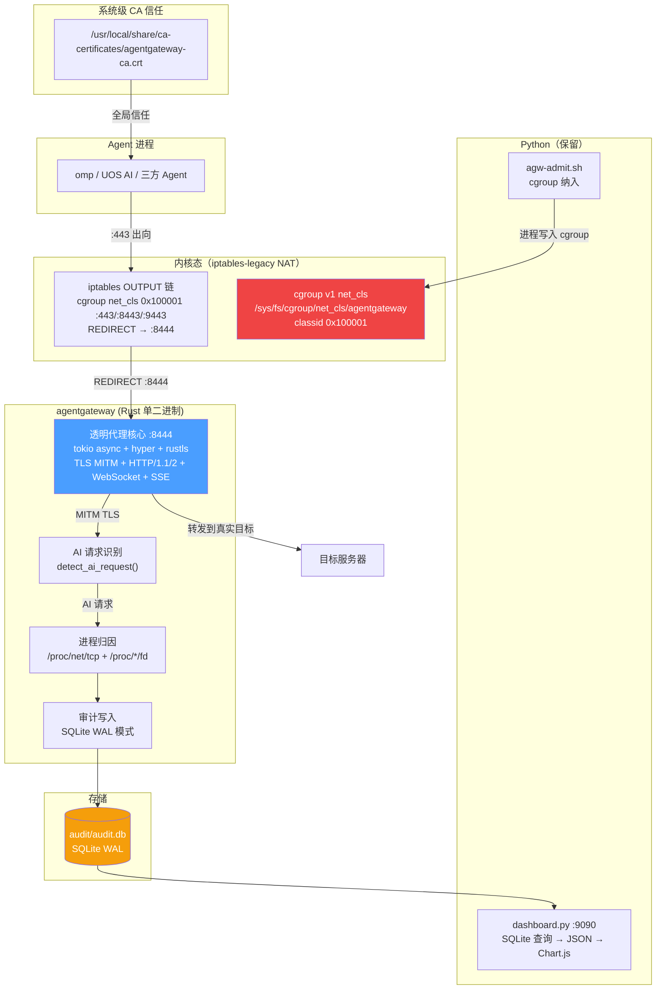

# 方案 C：混合方案（Rust 代理核心 + Python 仪表盘 + SQLite 审计存储）

> **Spec ID**: AGW-SPEC-C
> 创建时间：2026-11-26
> 前身：方案 A（Python mitmproxy 5.3.0）——因内存泄漏（dashboard 22GB + mitmdump 30GB = 52.9GB）导致系统卡死而重设
> 替代：`specs/方案A_透明代理进程级拦截_4.19内核.md`（保留作历史参考）

---

## 1. 背景与动机

### 1.1 方案 A 的致命问题

| 问题 | 根因 | 能否修复 |
|------|------|----------|
| mitmdump 951 线程 + 30.5GB 内存 | mitmproxy 5.3.0 同步线程模型，SSE 长连接每连接占一线程 | ❌ 架构限制 |
| dashboard.py 22.4GB 内存 | 全量读取 1.1GB audit.jsonl + 列表副本膨胀 | ✅ 可修复 |
| audit.jsonl 膨胀到 1.1GB | request_body 存完整对话历史（98KB/行） | ✅ 可修复 |

### 1.2 方案 C 的核心改进

1. **Rust 替代 mitmproxy**——tokio async 多路复用，1000 并发 SSE = 16 线程，内存 < 50MB
2. **SQLite 替代 JSONL**——dashboard 按需查询而非全量读取，内存 < 10MB
3. **单二进制 + Python dashboard**——proxy 编译为单二进制，dashboard 保留 Python（修复后内存可控）
4. **cgroup + iptables 不变**——进程隔离机制与方案 A 完全相同

---

## 2. 架构



### 数据流

1. **agw-admit** 将 Agent 进程写入 cgroup `net_cls/agentgateway`（classid 0x100001）
2. Agent 发起 HTTPS → iptables OUTPUT 链匹配 cgroup classid → REDIRECT 到 :8444
3. Rust 代理收到连接 → `SO_ORIGINAL_DST` 获取原始目标 → rustls MITM TLS
4. hyper 解析明文 HTTP → `detect_ai_request()` L7 识别
5. AI 请求 → `/proc/net/tcp` + `/proc/*/fd` 进程归因 → SQLite 审计写入 → 转发
6. 非 AI 请求 → 直接转发（仍经 MITM TLS，但无审计）
7. Dashboard 通过 SQLite 查询审计数据，在 `:9090` 展示
8. 其他进程的 :443 流量不匹配 cgroup → 直连，零影响

---

## 3. 核心组件

### 3.1 Rust 代理核心（`agentgateway`）

| 属性 | 值 |
|---|---|
| 语言 | Rust 1.84+ |
| 运行时 | tokio（async，固定线程池 = CPU 核数） |
| HTTP | hyper 1.x（HTTP/1.1 + HTTP/2） |
| TLS | rustls 0.23 + rcgen 0.13（动态证书生成） |
| WebSocket | tokio-tungstenite 0.24 |
| SQLite | rusqlite 0.32（WAL 模式） |
| 监听 | 127.0.0.1:8444（iptables REDIRECT 目标端口） |
| 模式 | transparent（`SO_ORIGINAL_DST` 获取原始目标） |
| 内存 | < 50MB（1000 并发 SSE 长连接） |
| 线程 | 16（CPU 核数，非每连接一线程） |

**与方案 A 对比**：

| 维度 | 方案 A（mitmproxy 5.3.0） | 方案 C（Rust） |
|------|--------------------------|----------------|
| 线程模型 | 同步（每连接一线程） | async（tokio 线程池） |
| 1000 并发 SSE | 951 线程 + 30GB | 16 线程 + 50MB |
| HTTP/2 | ❌ 不支持 | ✅ hyper 原生 |
| 内存安全 | ❌ GC 不及时 | ✅ 无 GC |
| 部署 | mitmproxy + python3 + addon | 单二进制 |

**Cargo.toml 核心依赖**：
```toml
[dependencies]
tokio = { version = "1", features = ["full"] }
hyper = { version = "1", features = ["full"] }
hyper-util = { version = "0.1", features = ["full"] }
rustls = "0.23"
tokio-rustls = "0.26"
rcgen = "0.13"
rusqlite = { version = "0.32", features = ["bundled"] }
serde = { version = "1", features = ["derive"] }
serde_json = "1"
http-body-util = "0.1"
bytes = "1"
clap = { version = "4", features = ["derive"] }
```

### 3.2 SQLite 审计存储

**替代 `audit/audit.jsonl`**，使用 `audit/audit.db`（SQLite WAL 模式）。

**表结构**：
```sql
CREATE TABLE IF NOT EXISTS events (
    id          INTEGER PRIMARY KEY AUTOINCREMENT,
    ts          TEXT NOT NULL,           -- ISO 8601 UTC
    ts_unix     REAL NOT NULL,           -- Unix timestamp
    event       TEXT NOT NULL,           -- ai_request_audited / ai_response
    decision    TEXT,                    -- AUDIT / FORWARD / BLOCK
    request_id  TEXT,
    agent_id    TEXT,
    session_id  TEXT,
    app_name    TEXT,
    method      TEXT,
    host        TEXT,
    port        INTEGER,
    path        TEXT,
    model       TEXT,
    confidence  INTEGER,
    signals     TEXT,                    -- JSON array
    preview     TEXT,
    prompt_len  INTEGER,
    stream_mode INTEGER,                 -- 0/1
    request_headers  TEXT,               -- JSON
    request_body     TEXT,               -- JSON (截断到 64KB)
    response_status  INTEGER,
    response_headers TEXT,                -- JSON
    response_body    TEXT,               -- JSON (截断到 64KB)
    token_usage TEXT,                    -- JSON
    latency_ms  INTEGER,
    summary     TEXT,
    source      TEXT
);
CREATE INDEX IF NOT EXISTS idx_ts       ON events(ts_unix DESC);
CREATE INDEX IF NOT EXISTS idx_req_id   ON events(request_id);
CREATE INDEX IF NOT EXISTS idx_agent    ON events(agent_id);
CREATE INDEX IF NOT EXISTS idx_event    ON events(event);
```

**日志清理**（替代 JSONL 轮转）：
```sql
-- 保留最近 7 天 + 最多 50000 行
DELETE FROM events WHERE ts_unix < strftime('%s','now','-7 days');
DELETE FROM events WHERE id NOT IN (SELECT id FROM events ORDER BY id DESC LIMIT 50000);
```

**WAL 模式**：读写互不阻塞，dashboard 查询不影响代理写入。

**JSONL 兼容**：`audit_log()` 可选同时写 JSONL（`audit/audit.jsonl`）作为人类可读备份，但 dashboard 只读 SQLite。

### 3.3 Python Dashboard（修复后保留）

| 属性 | 值 |
|---|---|
| 数据源 | SQLite 查询（替代 JSONL 全量读取） |
| 内存 | < 10MB（只加载查询结果集） |
| 技术 | Python stdlib `http.server` + `sqlite3` + Chart.js (CDN) |

**关键改动**：

```python
import sqlite3

def get_db():
    """Get SQLite connection (WAL mode, read-only)."""
    conn = sqlite3.connect(AUDIT_DB, timeout=5)
    conn.row_factory = sqlite3.Row
    conn.execute("PRAGMA journal_mode=WAL")
    return conn

def get_ai_requests(limit=200):
    """Query AI requests with matching responses — O(limit), not O(n)."""
    db = get_db()
    rows = db.execute("""
        SELECT r.*, resp.response_status, resp.response_body,
               resp.token_usage, resp.latency_ms
        FROM events r
        LEFT JOIN events resp ON r.request_id = resp.request_id
            AND resp.event = 'ai_response'
        WHERE r.event = 'ai_request_audited'
        ORDER BY r.ts_unix DESC
        LIMIT ?
    """, (limit,)).fetchall()
    db.close()
    return [dict(r) for r in rows]

def get_stats():
    """Aggregate stats — SQL GROUP BY, not Python list comprehension."""
    db = get_db()
    # ...
```

**消除的内存问题**：
- 不再 `read_audit_events()` 全量加载 → 改为 `SELECT ... LIMIT N`
- 不再 `blocked + forwarded + audited` 创建 3 份列表副本 → 改为 `SELECT COUNT(*) WHERE decision = ?`
- 不再 `get_ai_requests()` 遍历全表匹配 → 改为 `LEFT JOIN`
- 不再需要 mtime 缓存（I10）——SQLite 查询本身是 O(limit)

### 3.4 cgroup + iptables（不变）

与方案 A 完全相同：

```bash
# iptables-legacy REDIRECT
/usr/sbin/iptables-legacy -t nat -A OUTPUT \
  -p tcp --dport 443 \
  -m cgroup --cgroup 0x100001 \
  -j REDIRECT --to-port 8444
```

**环路防止**：Rust 代理以普通用户运行（不在 agentgateway cgroup 中），其出向 :443 连接不匹配 cgroup 规则。

### 3.5 CA 管理

Rust 代理启动时：
1. 检查 `~/.agentgateway/ca.pem`（CA 私钥）和 `~/.agentgateway/ca-cert.pem`（CA 公钥证书）
2. 不存在则用 `rcgen` 生成自签名 CA
3. 运行时对每个 TLS 连接的 SNI hostname 动态生成叶子证书，用 CA 签名
4. 叶子证书缓存在 `DashMap`（LRU，最多 1000 个 hostname）

**安装到系统 CA**（`setup_iptables.sh`）：
```bash
cp ~/.agentgateway/ca-cert.pem \
   /usr/local/share/ca-certificates/agentgateway-ca.crt
update-ca-certificates
```

### 3.6 进程归因（Rust 重写）

与方案 A 逻辑相同，用 Rust 实现：
1. 从 `flow.client_conn` 获取客户端 peer_port
2. 扫描 `/proc/net/tcp` + `/proc/net/tcp6` 找到匹配的 socket inode
3. 遍历 `/proc/*/fd/*` 找到持有该 inode 的 PID
4. 读取 `/proc/<pid>/environ` 获取 `AGENTGATEWAY_*` 环境变量
5. 父进程链遍历找到真正的 Agent 进程
6. 缓存（`DashMap`，30s TTL）

### 3.7 agw-admit.sh（不变）

与方案 A 完全相同：写入 cgroup tasks + 设置环境变量 + exec Agent。

### 3.8 setup_iptables.sh（微调）

- CA 生成改为运行 Rust 二进制（`agentgateway --gen-ca`）而非 `timeout 3 mitmdump`
- 其余不变（modprobe + cgroup + iptables + CA 安装）

### 3.9 start.sh（简化）

```bash
./start.sh start    # 启动 agentgateway (Rust) + dashboard.py (Python)
./start.sh stop     # 停止
./start.sh status   # 状态
./start.sh setup    # 一次性设置（root）
```

不再需要 `mitmdump` 命令——直接运行 `./agentgateway`。

---

## 4. 文件清单

```
agentgateway/
├── Cargo.toml                   # Rust 项目配置
├── src/
│   ├── main.rs                  # CLI (start/stop/status + 代理启动)
│   ├── proxy.rs                 — 透明代理核心 (SO_ORIGINAL_DST + 连接转发)
│   ├── tls.rs                   — CA 管理 + 动态证书生成 (rcgen + rustls)
│   ├── http_mitm.rs             — HTTP/1.1/2 MITM (hyper)
│   ├── detect.rs                — AI 请求识别 (路径/Header/Body 信号)
│   ├── attribution.rs           — 进程归因 (/proc/net/tcp + /proc/*/fd)
│   ├── audit.rs                 — SQLite 审计写入
│   └── config.rs                — 配置常量
├── dashboard/
│   ├── dashboard.py             # Web 仪表盘 (改用 SQLite 查询)
│   └── dashboard_template.html
├── setup_iptables.sh            # 一次性 root 设置 (微调 CA 生成)
├── start.sh                     # 生命周期管理 (简化)
├── agw-admit.sh                 # Agent cgroup 纳入 (不变)
├── audit/
│   ├── audit.db                 # SQLite 审计数据库 (新)
│   └── audit.db-wal             # WAL 文件
├── specs/
│   ├── 方案C_混合方案.md          # 本文档
│   ├── 方案A_透明代理进程级拦截_4.19内核.md  # 历史参考
│   └── 方案A_缺陷审查.md          # 历史参考
├── logs/
└── bpf/                         # BPF-LSM (6.6+ 内核未来扩展)
```

**删除的文件**：
- `gateway/agw_addon.py`（Rust 替代）
- `gateway/agentgatewayd.py`（Rust 替代，~1640 行 Python → ~1450 行 Rust）
- `gateway/gen_ca.py`（Rust 内置 CA 生成）
- `audit/audit.jsonl`（SQLite 替代）
- `certs/`（Rust 管理 CA）
- `gateway/transparent_proxy.py`（已删除）

---

## 5. 限制与诚实边界

| 限制 | 影响 | 缓解 |
|---|---|---|
| 需 root 设置 iptables | 一次性操作 | setup 脚本 + askpass |
| cgroup v1 net_cls 已弃用 | 4.19 仍完全支持 | 6.6+ 迁移到 cgroup v2 + BPF |
| Agent 可移出 cgroup | 有限强制，非完全不可绕过 | 需 6.6+ BPF-LSM 强制 |
| 仅拦截 TCP :443/:8443/:9443 | 非 443 端口和 UDP/QUIC 不拦截 | 扩展 iptables 端口或用 BPF |
| IPv6 不受 cgroup net_cls 约束 | IPv6 流量绕过拦截 | cgroup v1 固有限制 |
| cert pinning 应用 | 不信任系统 CA | 需 6.6+ BPF uprobe |
| Java truststore 独立 | Java 应用不读取系统 CA | 手动 keytool 导入 |
| rustls 不支持旧 cipher | 极少数旧服务器 TLS 失败 | 可选 `openssl` crate 兜底 |
| 无文件管控 | 无法限制文件读写 | 需 6.6+ BPF-LSM |
| 无自保护 | Agent 可杀网关进程 | 需 6.6+ BPF-LSM |
| SQLite 单文件 | 并发写入受限于单写者 | WAL 模式 + 写入频率低（每请求 1 次） |

---

## 6. 前置条件

- Rust 1.84+（已安装：`rustc 1.84.0`）
- Python 3.7+（dashboard）
- root 权限（一次性设置：modprobe + cgroup + iptables + CA）
- xt_cgroup.ko 内核模块（4.19 默认提供）

---

## 7. 部署与运行

### 7.1 编译

```bash
cd agentgateway
cargo build --release
# 产物：target/release/agentgateway
```

### 7.2 一次性设置

```bash
./start.sh setup    # root: modprobe + cgroup + iptables + CA
```

### 7.3 启动

```bash
./start.sh start    # 启动 Rust 代理 + Python dashboard
```

### 7.4 启动 Agent

```bash
./agw-admit.sh --app OMP /path/to/omp
```

### 7.5 验证

```bash
./start.sh status
# http://127.0.0.1:9090
sqlite3 audit/audit.db "SELECT event, host, model, response_status FROM events ORDER BY id DESC LIMIT 5;"
```
