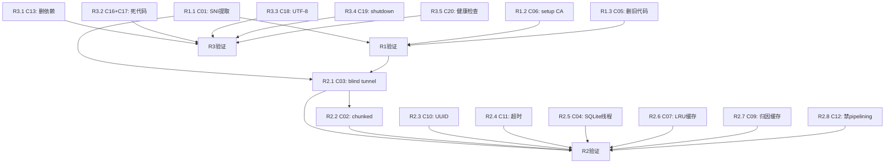

# 方案 C 缺陷修复计划

> 基于 `specs/方案C_缺陷审查.md` 的 20 个缺陷
> 创建时间：2026-11-26
> 预计总工期：2 天

---

## 修复阶段划分

```
阶段 R1：P0 立即修复（阻断端到端可用）     ← 0.5 天
  R1.1 C01: SNI 提取 + 证书域名匹配
  R1.2 C06: setup_iptables.sh 改用 certs/ca-cert.pem
  R1.3 C05: 删除旧 Python 代理代码
  └── 验证：Rust 代理 + iptables + curl 端到端 HTTPS MITM

阶段 R2：P1 可靠性修复                     ← 1 天
  R2.1 C03+C14+C15: 非 AI host blind tunnel
  R2.2 C02+C08: chunked 请求/响应正确处理
  R2.3 C10: 真随机 request_id
  R2.4 C11: 连接/读取超时
  R2.5 C04: SQLite 写入移到专用线程
  R2.6 C07: 证书缓存 LRU 上限
  R2.7 C09: attribution 缓存 key 改进
  R2.8 C12: 禁用 pipelining
  └── 验证：并发 AI 请求 + 非 AI 混合 + 长时间运行

阶段 R3：P2 可维护性修复                    ← 0.5 天
  R3.1 C13: 移除未使用依赖
  R3.2 C16+C17: 删除死代码
  R3.3 C18: UTF-8 安全截断
  R3.4 C19: graceful shutdown
  R3.5 C20: start.sh 健康检查替代 sleep
  └── 验证：cargo test + cargo build 无 warning
```

---

## 阶段 R1：P0 立即修复

### R1.1 C01 — SNI 提取 + 证书域名匹配

**根因**：`proxy.rs handle_tls_mitm()` 用 `orig_dst.ip().to_string()` 作 hostname 生成证书和连接上游，而非从 TLS ClientHello 提取 SNI。

**修复方案**：使用 `tokio_rustls::LazyConfigAcceptor` 在 TLS 握手前读取 ClientHello，提取 SNI hostname。

**改动文件**：`src/proxy.rs`、`src/tls.rs`、`src/http_mitm.rs`

**`src/proxy.rs` 改动**：

```rust
async fn handle_tls_mitm(
    client: TcpStream,
    orig_dst: SocketAddr,
    peer_addr: SocketAddr,
    certifier: Arc<Certifier>,
    connector: Arc<UpstreamConnector>,
) -> Result<(), BoxError> {
    // 1. 用 LazyConfigAcceptor 读取 ClientHello，提取 SNI
    let mut lazy = tokio_rustls::LazyConfigAcceptor::new(
        rustls::server::Acceptor::default(),
        client,
    );
    let start = lazy.accept().await
        .map_err(|e| format!("TLS accept (lazy): {e}"))?;

    let sni = start.client_hello().server_name()
        .map(|s| s.to_string());

    // 2. 用 SNI hostname 生成证书 + ServerConfig
    let hostname = sni.as_deref().unwrap_or("unknown");
    let server_config = certifier.server_config(hostname)?;

    // 3. 完成 TLS 握手
    let mut tls_client = start.into_stream(server_config).await
        .map_err(|e| format!("TLS into_stream: {e}"))?;

    // 4. 连接上游：用 SNI 作 ServerName（而非 IP）
    let upstream_tls = connector.connect_tls(orig_dst, sni.as_deref()).await?;

    // 5. 处理 HTTP
    crate::http_mitm::process_http(
        &mut tls_client, upstream_tls, orig_dst, peer_addr, sni.as_deref(),
    ).await
}
```

**`src/http_mitm.rs` 改动**：

```rust
// connect_tls 接受可选 SNI
pub async fn connect_tls(
    &self,
    addr: SocketAddr,
    sni: Option<&str>,
) -> Result<tokio_rustls::client::TlsStream<TcpStream>, BoxError> {
    let tcp = self.connect_tcp(addr).await?;
    // 用 SNI hostname 作 ServerName；无 SNI 时回退到 IP
    let server_name = match sni {
        Some(h) => rustls::pki_types::ServerName::try_from(h.to_string())
            .map_err(|e| format!("server name: {e}"))?,
        None => rustls::pki_types::ServerName::try_from(addr.ip().to_string())
            .map_err(|e| format!("server name: {e}"))?,
    };
    let connector = tokio_rustls::TlsConnector::from(self.tls_config.clone());
    let tls = connector.connect(server_name, tcp).await?;
    Ok(tls)
}

// process_http 接收 sni 参数，用 SNI 作 host 而非 IP
pub async fn process_http(
    client: &mut TlsStream<TcpStream>,
    mut upstream: tokio_rustls::client::TlsStream<TcpStream>,
    orig_dst: SocketAddr,
    peer_addr: SocketAddr,
    sni: Option<&str>,
) -> Result<(), BoxError> {
    let host = sni.unwrap_or_else(|| orig_dst.ip().to_string()).to_string();
    // ... 其余不变，host 用 SNI
}
```

**验证**：
```bash
# 启动代理
./target/release/agentgateway --port 8444 &
# 用 agw-admit + curl 发送 HTTPS 请求
./agw-admit.sh --app "TestApp" curl -sS \
  --cacert certs/ca-cert.pem \
  https://ai.uniontech.com/v1/chat/completions \
  -H 'Authorization: Bearer test' \
  -d '{"model":"glm-5","messages":[{"role":"user","content":"hi"}]}'
# 检查审计记录
sqlite3 audit/audit.db "SELECT host, path, model FROM events ORDER BY id DESC LIMIT 1;"
# host 应为域名而非 IP
```

---

### R1.2 C06 — setup_iptables.sh 改用 certs/ca-cert.pem

**改动文件**：`setup_iptables.sh`

**改动内容**：

```bash
# 旧（删除）:
MITM_CA_DIR="$HOME/.mitmproxy"
MITM_CA_SRC="$MITM_CA_DIR/mitmproxy-ca-cert.pem"
if [[ ! -f "$MITM_CA_SRC" ]]; then
    timeout 3 mitmdump --quiet 2>/dev/null || true
fi

# 新:
CA_SRC="$SCRIPT_DIR/certs/ca-cert.pem"

# 如果 CA 不存在，先运行 Rust 代理生成
if [[ ! -f "$CA_SRC" ]]; then
    echo "[setup] CA not found, generating via agentgateway..."
    timeout 3 "$SCRIPT_DIR/target/release/agentgateway" --port 0 2>/dev/null || true
    # 或 debug build
    timeout 3 "$SCRIPT_DIR/target/debug/agentgateway" --port 0 2>/dev/null || true
fi
```

**NSS DB 安装也改**：
```bash
# 旧: certutil ... -n "mitmproxy" -i "$MITM_CA_SRC"
# 新: certutil ... -n "agentgateway" -i "$CA_SRC"
certutil -d "sql:$NSSDB" -D -n "mitmproxy" 2>/dev/null || true  # 清理旧 nickname
certutil -d "sql:$NSSDB" -A -t "C,," -n "agentgateway" -i "$CA_SRC"
```

**帮助文本中"mitmproxy CA"改为"AgentGateway CA"**。

---

### R1.3 C05 — 删除旧 Python 代理代码

**删除文件**：
- `gateway/agentgatewayd.py`（70KB，Rust audit.rs + detect.rs + attribution.rs 替代）
- `gateway/agw_addon.py`（11KB，Rust http_mitm.rs 替代）
- `gateway/gen_ca.py`（3KB，Rust ca.rs 替代）
- `gateway/__pycache__/`（缓存目录）

**保留**：
- `gateway/` 目录可删除（如果为空），或保留 README 说明已迁移到 `src/`

**注意**：`dashboard/dashboard.py` 保留不动。

---

### R1 验证

```bash
# 1. 构建
cargo build --release

# 2. 设置 iptables（需 sudo）
sudo bash setup_iptables.sh

# 3. 启动
./start.sh start

# 4. 端到端测试
./agw-admit.sh --app "TestApp" curl -sS \
  --cacert certs/ca-cert.pem \
  -X POST https://ai.uniontech.com/v1/chat/completions \
  -H 'Content-Type: application/json' \
  -H 'Authorization: Bearer test-key' \
  -d '{"model":"glm-5","messages":[{"role":"user","content":"hello"}]}'

# 5. 检查审计记录
sqlite3 audit/audit.db \
  "SELECT event, host, path, model, response_status, latency_ms FROM events ORDER BY id DESC LIMIT 5;"

# 6. 检查 host 是域名而非 IP
# 预期：host = "ai.uniontech.com"（非 "x.x.x.x"）
```

---

## 阶段 R2：P1 可靠性修复

### R2.1 C03+C14+C15 — 非 AI host blind tunnel

**根因**：`proxy.rs handle_connection()` 对所有 TLS 连接做 MITM，`should_mitm_host()` 定义但未调用。

**修复方案**：在 `handle_tls_mitm()` 中用 `LazyConfigAcceptor` 提取 SNI 后，检查 `should_mitm_host(sni)`。不匹配则 blind tunnel。

**改动文件**：`src/proxy.rs`、`src/detect.rs`

```rust
// proxy.rs handle_connection() 改为：
async fn handle_connection(
    mut client: TcpStream,
    peer_addr: SocketAddr,
    certifier: Arc<Certifier>,
    connector: Arc<UpstreamConnector>,
) -> Result<(), BoxError> {
    let orig_dst = get_original_dst(&client)?;

    // Peek first byte to detect TLS
    let mut peek_buf = [0u8; 1];
    let n = client.peek(&mut peek_buf).await?;

    if n > 0 && peek_buf[0] == 0x16 {
        // TLS — 先用 LazyConfigAcceptor 提取 SNI
        let mut lazy = tokio_rustls::LazyConfigAcceptor::new(
            rustls::server::Acceptor::default(),
            client,
        );
        let start = lazy.accept().await?;
        let sni = start.client_hello().server_name()
            .map(|s| s.to_string());

        // 仅对 AI host 做 MITM
        if sni.as_deref().map(|h| detect::should_mitm_host(h)).unwrap_or(false) {
            // AI host — MITM
            let hostname = sni.as_deref().unwrap_or("unknown");
            let server_config = certifier.server_config(hostname)?;
            let mut tls_client = start.into_stream(server_config).await?;
            let upstream_tls = connector.connect_tls(orig_dst, sni.as_deref()).await?;
            crate::http_mitm::process_http(
                &mut tls_client, upstream_tls, orig_dst, peer_addr, sni.as_deref(),
            ).await
        } else {
            // 非 AI host — blind tunnel
            // 需要 take 回 client 流 + 已连接的 upstream
            let client = start.take_io().unwrap();
            let upstream = connector.connect_tcp(orig_dst).await?;
            // 注意：ClientHello 已被读取，需要 replay 给上游
            blind_tunnel_with_replay(client, upstream, start.received_client_hello()).await
        }
    } else {
        let upstream = connector.connect_tcp(orig_dst).await?;
        blind_tunnel(client, upstream).await
    }
}
```

> ⚠️ **技术难点**：`LazyConfigAcceptor` 消费了 ClientHello 字节。blind tunnel 时需要把已读的 ClientHello 字节 replay 给上游。`LazyConfigAcceptor` 提供了 `received_client_hello()` 方法获取已读字节。

**验证**：非 AI 请求（如 `curl https://www.baidu.com`）不走 MITM，直连速度正常。

---

### R2.2 C02+C08 — chunked 正确处理 + 无 Content-Length 响应

**改动文件**：`src/http_mitm.rs`

**`read_http_request` 改动**——补全 chunked 请求体：

```rust
async fn read_http_request<R: AsyncReadExt + Unpin>(
    reader: &mut R,
) -> Result<Option<Vec<u8>>, std::io::Error> {
    let mut buf = Vec::with_capacity(8192);
    let mut tmp = [0u8; 4096];

    loop {
        let n = reader.read(&mut tmp).await?;
        if n == 0 {
            if buf.is_empty() { return Ok(None); }
            break;
        }
        buf.extend_from_slice(&tmp[..n]);
        if let Some(pos) = find_header_end(&buf) {
            let header_end = pos + 4;
            let header_str = String::from_utf8_lossy(&buf[..pos]);
            let is_chunked = header_str.to_lowercase()
                .contains("transfer-encoding: chunked");
            let content_length = parse_content_length(&header_str);

            if is_chunked {
                // 读到 "0\r\n\r\n" — chunked 结束标记
                // 注意：必须检查 chunk 边界，不能简单搜索 b"0\r\n\r\n"
                loop {
                    if find_chunked_end(&buf, header_end).is_some() {
                        break;
                    }
                    let n = reader.read(&mut tmp).await?;
                    if n == 0 { break; }
                    buf.extend_from_slice(&tmp[..n]);
                }
            } else if let Some(cl) = content_length {
                while buf.len() < header_end + cl {
                    let n = reader.read(&mut tmp).await?;
                    if n == 0 { break; }
                    buf.extend_from_slice(&tmp[..n]);
                }
            }
            // 无 Content-Length 且非 chunked 的请求：body 为空（GET/DELETE 等）
            break;
        }
    }
    Ok(Some(buf))
}

/// 在 chunked 编码中找结束标记（最后一个 chunk 大小为 0）
/// 正确解析 chunk 边界，避免数据中的 "0\r\n\r\n" 误匹配
fn find_chunked_end(buf: &[u8], start: usize) -> Option<usize> {
    let mut pos = start;
    loop {
        // 找下一行（chunk size 行）
        let line_end = buf[pos..].windows(2).position(|w| w == b"\r\n")?;
        let line_end = pos + line_end;
        let size_str = std::str::from_utf8(&buf[pos..line_end]).ok()?;
        let chunk_size = usize::from_str_radix(
            size_str.split(';').next()?.trim(), 16
        ).ok()?;
        pos = line_end + 2;
        if chunk_size == 0 {
            // 最后一个 chunk，后面应该跟 \r\n（或 trailer headers + \r\n）
            // 找到 \r\n
            if pos + 2 <= buf.len() && &buf[pos..pos+2] == b"\r\n" {
                return Some(pos + 2);
            }
            // 可能有 trailer headers，继续找 \r\n\r\n
            if let Some(trailer_end) = buf[pos..].windows(4).position(|w| w == b"\r\n\r\n") {
                return Some(pos + trailer_end + 4);
            }
            return None; // 还没读完 trailer
        }
        pos += chunk_size + 2; // chunk data + \r\n
        if pos > buf.len() { return None; }
    }
}
```

**`read_http_response` 改动**——无 Content-Length 时检测 `Connection: close`：

```rust
// 在 read_http_response 的 else 分支（无 CL 无 chunked）：
} else {
    // 检查是否 Connection: close
    let is_close = header_str.to_lowercase()
        .contains("connection: close");
    if is_close {
        // 读直到 EOF（服务器会关连接）
        loop {
            let n = reader.read(&mut tmp).await?;
            if n == 0 { break; }
            buf.extend_from_slice(&tmp[..n]);
        }
    } else {
        // HTTP/1.1 keep-alive 无 body（如 204/304）
        // 不读 body，直接返回 header
    }
}
```

---

### R2.3 C10 — 真随机 request_id

**改动文件**：`src/http_mitm.rs`、`Cargo.toml`

**方案**：添加 `uuid` crate（`uuid = { version = "=1.11.0", features = ["v4"] }`），或用 `/dev/urandom` 无依赖。

**方案 A（推荐，无新依赖）**：

```rust
fn uuid_v4() -> String {
    use std::io::Read;
    let mut buf = [0u8; 16];
    if let Ok(mut f) = std::fs::File::open("/dev/urandom") {
        if f.read_exact(&mut buf).is_ok() {
            // 设置 version 4 和 variant 位
            buf[6] = (buf[6] & 0x0f) | 0x40;
            buf[8] = (buf[8] & 0x3f) | 0x80;
            return format!(
                "{:02x}{:02x}{:02x}{:02x}-{:02x}{:02x}-{:02x}{:02x}-{:02x}{:02x}-{:02x}{:02x}{:02x}{:02x}{:02x}{:02x}",
                buf[0], buf[1], buf[2], buf[3],
                buf[4], buf[5], buf[6], buf[7],
                buf[8], buf[9], buf[10], buf[11],
                buf[12], buf[13], buf[14], buf[15]
            );
        }
    }
    // fallback: 时间戳 + pid + counter
    static COUNTER: std::sync::atomic::AtomicU64 = std::sync::atomic::AtomicU64::new(0);
    let c = COUNTER.fetch_add(1, std::sync::atomic::Ordering::Relaxed);
    let now = std::time::SystemTime::now()
        .duration_since(std::time::UNIX_EPOCH)
        .unwrap().as_nanos();
    format!("req-fallback-{}-{}", now, c)
}
```

---

### R2.4 C11 — 连接/读取超时

**改动文件**：`src/proxy.rs`、`src/http_mitm.rs`

```rust
// proxy.rs — 上游 TCP 连接超时
pub async fn connect_tcp(&self, addr: SocketAddr) -> Result<TcpStream, std::io::Error> {
    let stream = tokio::time::timeout(
        Duration::from_secs(10),
        TcpStream::connect(addr),
    ).await;
    match stream {
        Ok(Ok(s)) => Ok(s),
        Ok(Err(e)) => Err(e),
        Err(_) => Err(std::io::Error::new(
            std::io::ErrorKind::TimedOut,
            "upstream connect timeout",
        )),
    }
}

// TLS 握手超时
let tls = tokio::time::timeout(
    Duration::from_secs(10),
    connector.connect(server_name, tcp),
).await.map_err(|_| "TLS handshake timeout")??;

// HTTP 读取超时
let req_data = tokio::time::timeout(
    Duration::from_secs(30),
    read_http_request(client),
).await.map_err(|_| "request read timeout")??;

let resp_data = tokio::time::timeout(
    Duration::from_secs(60),
    read_http_response(&mut upstream),
).await.map_err(|_| "response read timeout")??;
```

---

### R2.5 C04 — SQLite 写入移到专用线程

**改动文件**：`src/audit.rs`

**方案**：用 `std::sync::mpsc` channel 将审计事件发送到专用写入线程，`audit_log()` 不再持有 Mutex。

```rust
use std::sync::mpsc::{Sender, channel};

static TX: LazyLock<Option<Sender<AuditEvent>>> = LazyLock::new(|| None);

pub fn audit_init(db_path: &Path, jsonl_path: &Path) -> Result<(), String> {
    // ... 建 DB + schema ...

    let (tx, rx) = channel::<AuditEvent>();
    
    // 专用写入线程
    let conn = Connection::open(db_path)?;
    std::thread::spawn(move || {
        for event in rx {
            // INSERT to SQLite
            // write JSONL
        }
    });

    // 保存 sender
    {
        let mut tx_guard = TX.lock().unwrap();
        *tx_guard = Some(tx);
    }
    Ok(())
}

pub fn audit_log(event: &AuditEvent) {
    let tx = TX.lock().unwrap();
    if let Some(sender) = tx.as_ref() {
        let _ = sender.send(event.clone());  // 非阻塞，channel buffer 无限
    }
}
```

> AuditEvent 需要派生 Clone。

---

### R2.6 C07 — 证书缓存 LRU 上限

**改动文件**：`src/tls.rs`

**方案**：HashMap 改为手动 LRU——超过 1000 个条目时删除最早插入的。

```rust
struct CertCache {
    map: HashMap<String, Arc<TlsCert>>,
    order: VecDeque<String>,  // 插入顺序
    max_size: usize,
}

impl CertCache {
    fn get(&mut self, key: &str) -> Option<Arc<TlsCert>> {
        if let Some(c) = self.map.get(key) {
            return Some(c.clone());
        }
        None
    }

    fn insert(&mut self, key: String, val: Arc<TlsCert>) {
        if self.map.len() >= self.max_size {
            // 淘汰最旧
            if let Some(oldest) = self.order.pop_front() {
                self.map.remove(&oldest);
            }
        }
        self.order.push_back(key.clone());
        self.map.insert(key, val);
    }
}
```

> 简单 FIFO 淘汰即可，不需要真正的 LRU（证书生成成本低，淘汰后重新生成可接受）。

---

### R2.7 C09 — attribution 缓存 key 改进

**改动文件**：`src/attribution.rs`

**方案**：缓存 key 从 `peer_port` 改为 `(peer_port, peer_addr)`，减少端口复用误匹配。或缩短 TTL 到 5s。

```rust
// 缓存 key 改为 (peer_port, peer_ip)
struct CacheKey {
    port: u16,
    ip: std::net::IpAddr,
}

// TTL 从 30s 缩短到 5s
const CACHE_TTL: Duration = Duration::from_secs(5);
```

---

### R2.8 C12 — 禁用 pipelining

**改动文件**：`src/http_mitm.rs`

**方案**：每个请求处理后检查 `Connection: close`，或在响应头中加 `Connection: close` 强制关闭连接。最简单方案：处理完一个请求后不再 loop，直接返回（关闭连接）。

```rust
// process_http() 改为只处理一个请求（移除 loop）
pub async fn process_http(...) -> Result<(), BoxError> {
    // 读取一个请求
    let req_data = read_http_request(client).await?;
    // ... 处理 + 转发 + 审计 ...
    // 返回，不再 loop
    Ok(())
}
```

> 取舍：牺牲 HTTP keep-alive（每次请求重新 TLS 握手），换取正确性和简单性。后续可改为正确的 keep-alive 实现。

---

## 阶段 R3：P2 可维护性修复

### R3.1 C13 — 移除未使用依赖

**改动文件**：`Cargo.toml`

```toml
# 删除这三行：
# hyper = { version = "=1.5.1", features = ["full"] }
# hyper-util = { version = "=0.1.10", features = ["full"] }
# http-body-util = "=0.1.2"
```

同时删除 `http_mitm.rs` 头部注释"Uses hyper for HTTP/1.1 parsing"。

---

### R3.2 C16+C17 — 删除死代码

**`src/http_mitm.rs`**：
- 删除 `insecure` 字段（C16）
- 删除 `client_read_buf` 变量（C17）

```rust
// 旧：
pub struct UpstreamConnector {
    insecure: bool,  // 删除
    tls_config: Arc<rustls::ClientConfig>,
}
// 旧：
let mut client_read_buf: Vec<u8> = Vec::new();  // 删除
let _ = client_read_buf;                        // 删除
```

---

### R3.3 C18 — UTF-8 安全截断

**改动文件**：`src/audit.rs`

```rust
fn truncate_json(v: &Value) -> String {
    let s = serde_json::to_string(v).unwrap_or_default();
    if s.len() <= MAX_BODY_SIZE {
        return s;
    }
    // 找到不超过 MAX_BODY_SIZE 的 UTF-8 字符边界
    let mut end = MAX_BODY_SIZE;
    while end > 0 && !s.is_char_boundary(end) {
        end -= 1;
    }
    // 截断后加 "..." 表示被截断
    format!("{}...", &s[..end])
}
```

---

### R3.4 C19 — graceful shutdown

**改动文件**：`src/main.rs`、`Cargo.toml`

**方案**：添加 `tokio::signal` 处理 SIGTERM/SIGINT。

```rust
// Cargo.toml 不需要新依赖，tokio "full" 已包含 signal

// main.rs
use tokio::signal;

#[tokio::main]
async fn main() -> std::io::Result<()> {
    // ... 初始化 ...

    // 启动监听循环 in a task
    let server_handle = tokio::spawn(async move {
        loop {
            let (client_conn, peer_addr) = listener.accept().await?;
            // ... spawn handler ...
        }
    });

    // 等待 SIGTERM/SIGINT
    signal::unix::signal(signal::unix::SignalKind::terminate())?
        .recv().await;
    eprintln!("[SHUTDOWN] Received SIGTERM, shutting down...");

    // 停止接受新连接
    server_handle.abort();

    // 等待审计写入完成
    audit::flush().await;  // 新增：等待 channel 中的事件写完

    eprintln!("[SHUTDOWN] Done.");
    Ok(())
}
```

---

### R3.5 C20 — start.sh 健康检查替代 sleep

**改动文件**：`start.sh`

```bash
# 旧：sleep 0.5
# 新：轮询端口是否可连
wait_for_port() {
    local port=$1 timeout=$2
    for _ in $(seq 1 "$timeout"); do
        if timeout 1 bash -c "echo > /dev/tcp/127.0.0.1/$port" 2>/dev/null; then
            return 0
        fi
        sleep 0.2
    done
    return 1
}

# do_start() 中：
start_proc "proxy" "$(proxy_cmd)" "$PROXY_PIDFILE" "$PROXY_LOG"
wait_for_port 8444 50 || echo "[start.sh] WARNING: proxy port not ready"
start_proc "dashboard" "$PYTHON $DASHBOARD" "$DASHBOARD_PIDFILE" "$DASHBOARD_LOG"
```

---

## 验证检查清单

### R1 验证（P0 修复后）

- [ ] `cargo build --release` 无 error
- [ ] `cargo test` 4 个测试通过
- [ ] `sudo bash setup_iptables.sh` 安装 `certs/ca-cert.pem` 到系统 CA
- [ ] `./start.sh start` 启动 Rust 代理 + dashboard
- [ ] `./agw-admit.sh --app TestApp curl --cacert certs/ca-cert.pem https://ai.uniontech.com/...` 成功
- [ ] `sqlite3 audit/audit.db "SELECT host FROM events..."` host 是域名而非 IP
- [ ] `ls gateway/` 不存在或为空

### R2 验证（P1 修复后）

- [ ] 非 AI 请求（`curl https://www.baidu.com`）不走 MITM（审计日志无记录）
- [ ] chunked 请求体正确转发（`curl -H "Transfer-Encoding: chunked" ...`）
- [ ] SSE 流式响应完整转发（`"stream": true` 请求）
- [ ] 并发 10 个 AI 请求，request_id 无碰撞
- [ ] 上游不可达时 10s 超时（不永久阻塞）
- [ ] 1000 并发连接后内存稳定（< 100MB）
- [ ] 证书缓存不超过 1000 条目
- [ ] 1 小时运行后线程数稳定（< 20）

### R3 验证（P2 修复后）

- [ ] `cargo build --release` 无 warning
- [ ] `cargo test` 全部通过
- [ ] `./start.sh stop` 后审计日志完整（无丢失）
- [ ] JSONL 中无 UTF-8 乱码
- [ ] `start.sh start` 后 dashboard 立即可用（不等 sleep）

---

## 修复依赖关系



> **关键依赖**：R1.1（SNI 提取）是 R2.1（blind tunnel）的前置——blind tunnel 需要 SNI 判断 host 是否为 AI host。R1.1 和 R2.1 可在同一改动中完成。

---

## 风险与取舍

| 修复 | 风险 | 取舍 |
|------|------|------|
| R1.1 SNI 提取 | `LazyConfigAcceptor` API 较新，需要验证 Rust 1.84 兼容性 | 无替代方案，必须用 |
| R2.1 blind tunnel replay | ClientHello 字节需 replay 给上游，可能丢失 | 仔细处理 `received_client_hello()` |
| R2.2 chunked 解析 | 正确解析 chunk 边界复杂 | 简单场景优先（AI API 主要用 Content-Length） |
| R2.5 SQLite 专用线程 | channel 无限 buffer 可能内存增长 | 实际审计频率低（每 AI 请求 2 条），可接受 |
| R2.8 禁 pipelining | 牺牲 keep-alive 性能 | 正确性 > 性能，后续可改回 |
| R2.7 归因缓存 TTL 5s | 缓存命中率降低 | 正确性 > 性能 |
